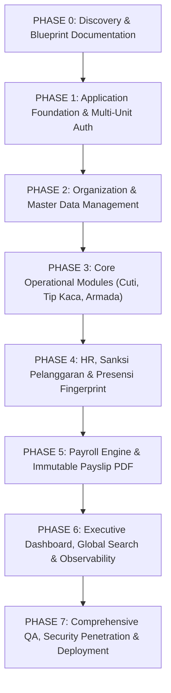

# DEVELOPMENT ROADMAP & ACCEPTANCE CRITERIA
## KUK Management System · Phased Implementation Plan
**Versi:** 3.0.0  
**Tanggal:** 2026-11-04  
**Status:** Roadmap Baseline / Phase 0 Final  

---

## 1. Ikhtisar Metodologi & Phase Gates

Pengembangan KUK Management System dieksekusi secara ketat menggunakan pendekatan bertahap (*staged execution*). Setiap fase memiliki cakupan terisolasi (*isolated scope*) dan tidak diperkenankan melangkah ke fase berikutnya sebelum seluruh **Kriteria Penerimaan (Acceptance Criteria)** fase aktif diverifikasi dan disetujui.

---

## 2. Rincian Fase & Deliverables

### PHASE 0 — Discovery, Arsitektur & Dokumentasi Blueprint (STATUS: SELESAI / CURRENT)
- **Tujuan**: Audit lingkungan kerja, isolasi dari aplikasi lama, perancangan blueprint arsitektur, ERD, skema database, aturan bisnis, matriks keamanan, dan rencana migrasi data.
- **Deliverables**:
  1. `docs/SYSTEM_BLUEPRINT.md`
  2. `docs/DATABASE_SCHEMA.md`
  3. `docs/ERD.md`
  4. `docs/BUSINESS_RULES.md`
  5. `docs/SECURITY_RULES.md`
  6. `docs/ROLE_PERMISSION_MATRIX.md`
  7. `docs/DEVELOPMENT_ROADMAP.md`
  8. `docs/MIGRATION_PLAN.md`
- **Acceptance Criteria**: Seluruh dokumen arsitektur saling sinkron, tidak ada ambiguitas logika bisnis, dan siap menjadi acuan tunggal fase implementasi.

---

### PHASE 1 — Fondasi Aplikasi & Multi-Unit Auth Shell
- **Tujuan**: Membangun fondasi frontend React + Vite + Tailwind + TypeScript dan integrasi backend Supabase Auth dengan mekanisme pemilihan unit (*Unit Selector*).
- **Cakupan Pekerjaan**:
  - Inisialisasi proyek di folder `d:\00. Me\07. Code Project\13. KUK V3`.
  - Konfigurasi Tailwind CSS dengan token visual KUK (Marun `#6B1D2F` / `#540000`, Emas `#D4AF37`, latar `#F9FAFB`).
  - Setup React Router v6 dengan *Route Guard* (Auth Guard, Unit Access Guard, Permission Guard).
  - Integrasi Supabase Client & Context Provider (`AuthContext`, `UnitContext`).
  - Implementasi Shell Header: Unit Selector Dropdown dengan indikator unit aktif.
  - Setup fondasi database Supabase (tabel `organizations`, `units`, `profiles`, `roles`, `permissions`, `role_permissions`, `user_unit_access`).
  - Setup skrip migrasi SQL & seeds akun Super Admin awal.
  - Setup Error Boundary, Toast Notification System, dan Global Loading Spinner.
- **Acceptance Criteria**:
  - [ ] Login staf berhasil menggunakan email/password Supabase Auth.
  - [ ] Logout membersihkan sesi dan state lokal secara sempurna.
  - [ ] Pengguna satu unit langsung masuk ke unitnya; pengguna multi-unit dapat berpindah unit via dropdown header.
  - [ ] Pergantian unit me-refresh query cache TanStack Query tanpa meninggalkan residu data unit sebelumnya.
  - [ ] Build proyek (`npm run build`) berjalan bersih tanpa error lint atau typecheck.

---

### PHASE 2 — Pengelolaan Master Data & Organisasi
- **Tujuan**: Menyediakan CRUD master data organisasi dan SDM sebagai sumber tunggal seluruh modul transaksi.
- **Cakupan Pekerjaan**:
  - Modul Unit Bisnis (TB KUK La Tansa, KUK Palen, penambahan unit baru).
  - Modul Departemen/Bagian per unit (Kasir, Admin, Gudang, Pengiriman, Frontliner).
  - Modul Jabatan per unit beserta tunjangan standar.
  - Modul Master Karyawan lengkap:
    - Input NIK, nomor telepon, tanggal masuk, status pernikahan, ID fingerprint, dan PIN mandiri.
    - Filter status: `ACTIVE`, `INACTIVE`, `RESIGNED`, `RETIRED`.
    - Riwayat mutasi jabatan/bagian (`employee_job_history`).
  - Modul Manajemen Staf Pengguna: Penugasan hak akses staf ke unit dan role terkait.
- **Acceptance Criteria**:
  - [ ] Karyawan baru dapat ditambahkan dan langsung muncul di seluruh dropdown modul.
  - [ ] Penonaktifan karyawan menyembunyikannya dari form baru tanpa menghapus data historis.
  - [ ] Mutasi departemen karyawan mencatat jejak mutasi dan tidak merusak slip/cuti lama.
  - [ ] Admin Unit Palen tidak dapat melihat daftar karyawan Unit La Tansa di antarmuka maupun REST API.

---

### PHASE 3 — Modul Operasional Dasar (Cuti, Tip Kaca, Armada)
- **Tujuan**: Menyelesaikan 3 modul operasional utama yang memiliki interaksi publik dan verifikasi staf.
- **Cakupan Pekerjaan**:
  - **Portal Publik Landing Page**: Tampilan 3 kartu utama (Peminjaman Kendaraan, Karyawan, Login Staf).
  - **Modul Cuti Karyawan**:
    - Form pengajuan cuti publik mandiri dengan verifikasi PIN.
    - Kalender pemilihan tanggal interaktif (kuota max 3 hari).
    - Server-side atomic validation (`submit_leave_request_atomic`): Jendela tgl 1 s/d 3, anti-bentrok departemen, aturan Admin 3 khusus hari Minggu.
    - Dashboard rekapitulasi cuti matriks internal untuk HRD/Admin.
    - Fitur pembatalan cuti berotorisasi.
  - **Modul Tip Pemotongan Kaca**:
    - Form publik input pemotongan (P x T x Qty x Tarif).
    - Rate limiter & perlindungan anti-spam.
    - Portal verifikasi internal tip kaca: Setujui, Revisi (*Adjust*), Tolak (*Reject*).
    - Rekapitulasi tip kaca terverifikasi per karyawan dan per divisi.
  - **Modul Armada Kendaraan**:
    - Katalog master kendaraan (Truk Engkel, L300, Motor) dengan status dan barcode Pertamina.
    - Form publik peminjaman armada dengan validasi anti-bentrok jadwal waktu (`book_vehicle_atomic`).
    - Alur persetujuan admin armada.
    - Antarmuka inspeksi Check-Out & Check-In (KM, BBM, foto fisik).
    - Pencatatan kerusakan kendaraan & log pengisian BBM.
- **Acceptance Criteria**:
  - [ ] Pengajuan cuti bersamaan pada detik yang sama di departemen yang sama hanya meloloskan 1 pengajuan; pengajuan kedua tertolak aman.
  - [ ] Nominal tip kaca dari form publik dihitung murni di server dan wajib diverifikasi sebelum masuk payroll.
  - [ ] Peminjaman kendaraan menolak jadwal yang tumpang tindih dengan peminjaman yang telah disetujui.
  - [ ] Form publik sama sekali tidak mengekspos data gaji pokok atau rincian pribadi staf.

---

### PHASE 4 — HR, Kepatuhan & Presensi Fingerprint
- **Tujuan**: Mengotomatisasi pemantauan kedisiplinan dan integrasi absensi mesin fisik.
- **Cakupan Pekerjaan**:
  - **Modul Pelanggaran Kerja**:
    - Pencatatan insiden kerja, kategori, bukti foto, dan poin pelanggaran.
    - Engine akumulasi poin pelanggaran aktif per karyawan.
    - Notifikasi peringatan saat mencapai ambang SP1 (20 poin), SP2 (40 poin), SP3 (60 poin), atau evaluasi PHK (100 poin).
    - Generator Surat Peringatan resmi berformat PDF.
  - **Modul Presensi Briefing Pagi**:
    - Formulir input cepat presensi briefing harian (Hadir, Izin, Sakit, Terlambat, Alpa).
    - Rekapitulasi kehadiran harian dan bulanan per bagian.
  - **Modul Impor Log Mesin Fingerprint**:
    - Unggah berkas log CSV / Excel dari mesin fisik.
    - Layar preview dan validasi kolom sebelum komit ke database.
    - Penyimpanan log mentah ke `fingerprint_raw_logs` (tidak pernah diubah).
    - Engine kalkulasi keterlambatan, jam kerja, dan lembur harian.
    - Penanganan deviasi dan koreksi manual berjejak audit di `attendance_adjustments`.
- **Acceptance Criteria**:
  - [ ] Poin pelanggaran terakumulasi otomatis dan menerbitkan template surat SP yang valid.
  - [ ] Berkas CSV mesin fingerprint dapat diimpor, dideteksi duplikasi barisnya, dan dipetakan akurat ke `employee_id`.
  - [ ] Koreksi manual presensi mewajibkan input alasan dan tercatat nama staf pengoreksi.

---

### PHASE 5 — Penggajian / Payroll Engine
- **Tujuan**: Membangun mesin penggajian komprehensif yang akurat, aman, dan menghasilkan slip gaji berkekuatan hukum.
- **Cakupan Pekerjaan**:
  - Database komponen penghasilan dan potongan per unit.
  - Penarikan otomatis tip kaca berstatus `VERIFIED` untuk periode bersangkutan.
  - Perhitungan otomatis Gaji Bersih = Total Pendapatan - Total Potongan.
  - Antarmuka *Preview Payroll* sebelum finalisasi dengan fitur penyesuaian manual berotorisasi.
  - Prosedur finalisasi atomik (`calculate_and_finalize_payroll`):
    - Pembekuan snapshot master karyawan, jabatan, dan item nominal.
    - Penandaan transaksi tip agar tidak ditarik ganda di periode berikutnya.
    - Pembuatan nomor slip gaji resmi berurut unik.
  - Generator Slip Gaji PDF standar cetak (mendukung cetak A4 dan struk thermal).
  - Mekanisme pembatalan/revisi khusus berizin Super Admin dengan jejak audit ketat.
- **Acceptance Criteria**:
  - [ ] Tip kaca yang belum diverifikasi terbukti tidak ikut tertarik ke kalkulasi payroll.
  - [ ] Mengubah gaji pokok pada master karyawan pasca-finalisasi terbukti tidak mengubah angka pada slip gaji periode yang telah ditutup.
  - [ ] Slip gaji PDF tercetak presisi dengan kop resmi unit dan rincian komponen pendapatan/potongan.
  - [ ] Staf non-payroll / operator tidak dapat membuka modul atau kueri data payroll.

---

### PHASE 6 — Sistem Pendukung, Analitik & Observability
- **Tujuan**: Melengkapi sistem dengan antarmuka eksekutif, alat bantu produktivitas, dan transparansi jejak operasional.
- **Cakupan Pekerjaan**:
  - **Dashboard Pusat**: Metrik agregat seluruh unit (total staf, rasio kedisiplinan, ringkasan pengeluaran payroll, utilisasi armada).
  - **Dashboard Unit**: Metrik real-time operasional unit aktif (karyawan hadir hari ini, cuti aktif, tugas verifikasi tip pending, status armada).
  - **Fitur Ekspor Excel Terpadu**: Komponen SheetJS untuk ekspor rekap data tabel di seluruh modul sesuai filter aktif.
  - **Global Search (Ctrl+K)**: Dialog pencarian cepat untuk melompat ke profil karyawan, nomor slip, atau armada kendaraan sesuai izin pengguna.
  - **Pusat Notifikasi & Task Alert**: Notifikasi pengajuan cuti baru, tip pending verifikasi, dan jatuh tempo STNK kendaraan.
  - **Viewer Audit Log & Activity Log**: Panel penelusuran riwayat mutasi data bagi Super Admin.
  - **Pengaturan Periode & Format Penomoran Dokumen**: Konfigurasi kode dokumen dinamis.
- **Acceptance Criteria**:
  - [ ] Dashboard merespons pergantian unit secara instan dan akurat.
  - [ ] Ekspor Excel menghasilkan berkas spreadsheet bersih yang sesuai dengan data yang sedang ditampilkan.
  - [ ] Dialog Ctrl+K hanya menampilkan hasil pencarian yang diizinkan untuk role staf aktif.
  - [ ] Audit log merekam setiap perubahan data kritis dengan rincian nilai sebelum dan sesudah.

---

### PHASE 7 — QA, Audit Keamanan, UAT & Deployment
- **Tujuan**: Pengujian menyeluruh lintas perangkat dan peluncuran sistem ke lingkungan production.
- **Cakupan Pekerjaan**:
  - Eksekusi rangkaian uji keamanan RLS (*Security Test Suite* 6 skenario wajib).
  - Pengujian kompatibilitas responsif di desktop, tablet, dan smartphone (Android Chrome / Safari iOS).
  - Uji beban (*stress testing*) pada RPC transaksi atomik cuti dan armada.
  - Simulasi prosedur *Backup & Disaster Recovery* database Supabase.
  - User Acceptance Testing (UAT) bersama perwakilan staf unit TB KUK La Tansa dan KUK Palen.
  - Deployment frontend ke Vercel dengan konfigurasi domain resmi KUK.
  - Migrasi data awal dari sistem lama (mengikuti `MIGRATION_PLAN.md`).
- **Acceptance Criteria**:
  - [ ] Seluruh skenario pengujian unit, integrasi, dan keamanan berstatus PASS.
  - [ ] Tidak ada kebocoran kredensial atau Service Role Key pada bundel frontend production.
  - [ ] Pengguna staf berhasil mengoperasikan seluruh modul harian tanpa kendala teknis.
  - [ ] Sistem resmi dinyatakan *Production-Ready*.

---

## 3. Definition of Done (DoD) per Modul

Suatu modul dianggap selesai (*Done*) jika memenuhi kriteria wajib:
1. **Database & Migrations**: Skema tabel, foreign key, index performa, dan kebijakan RLS telah terpasang dan lolos uji.
2. **Server-Side Validation**: Seluruh aturan bisnis tervalidasi pada RPC/Edge Function dengan skema Zod.
3. **UI/UX Standar KUK**: Menggunakan tema warna marun-emas, tipografi bersih, responsif, memiliki empty state, loading state, error alert, dan modal konfirmasi aksi krusial.
4. **Audit Trail**: Setiap mutasi data memicu pencatatan audit log otomatis.
5. **Ekspor & Cetak**: Menyediakan tombol ekspor Excel bersih dan cetak PDF jika relevan.
6. **Type Safety & Build**: Lolos typecheck TypeScript (`tsc --noEmit`) tanpa penggunaan `any` atau `@ts-ignore`.

