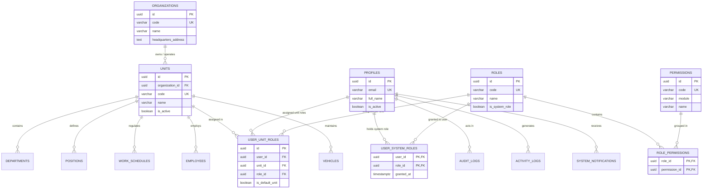
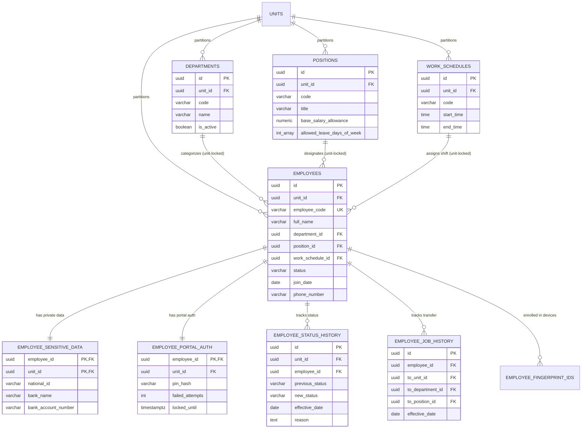
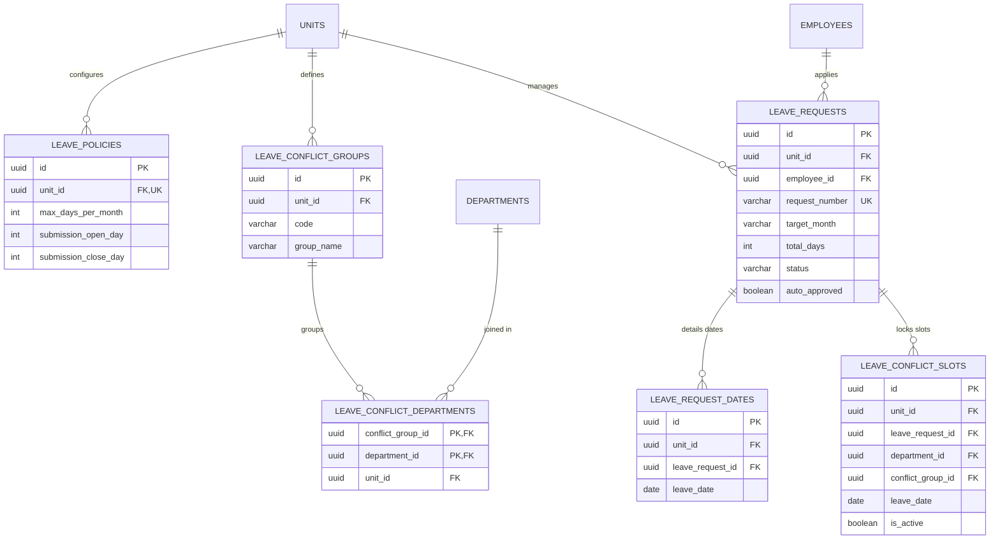
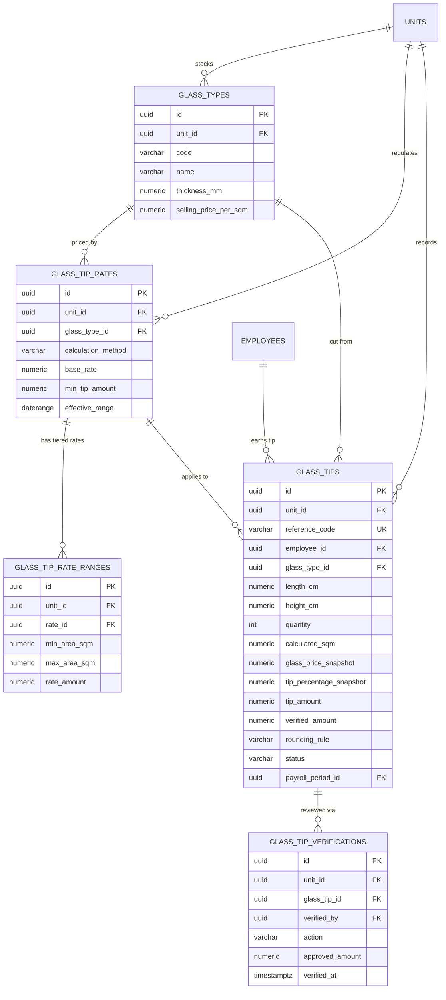
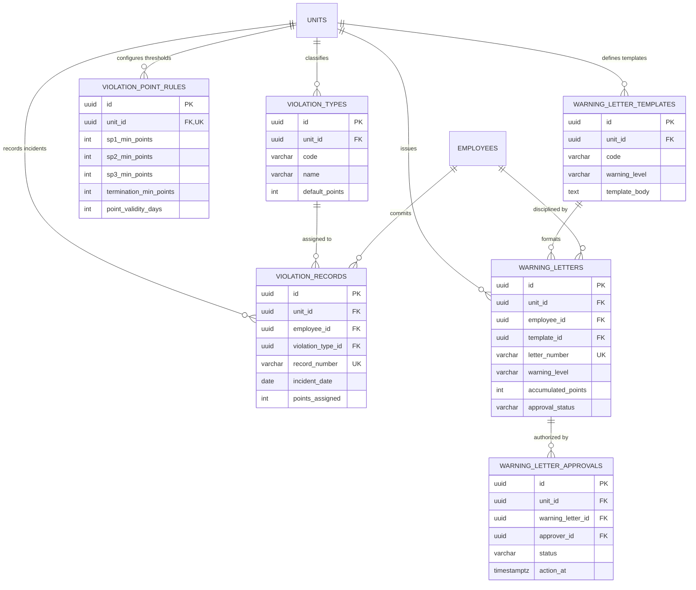
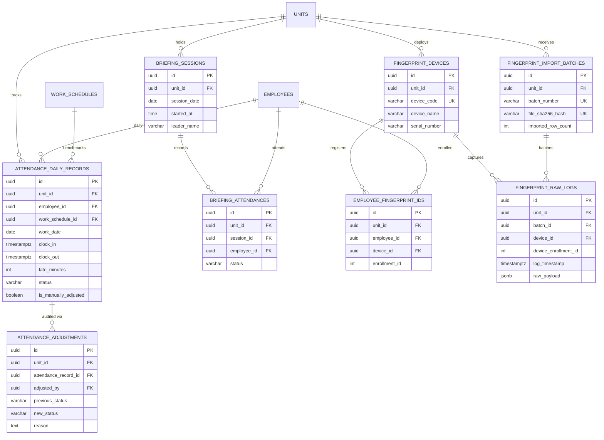
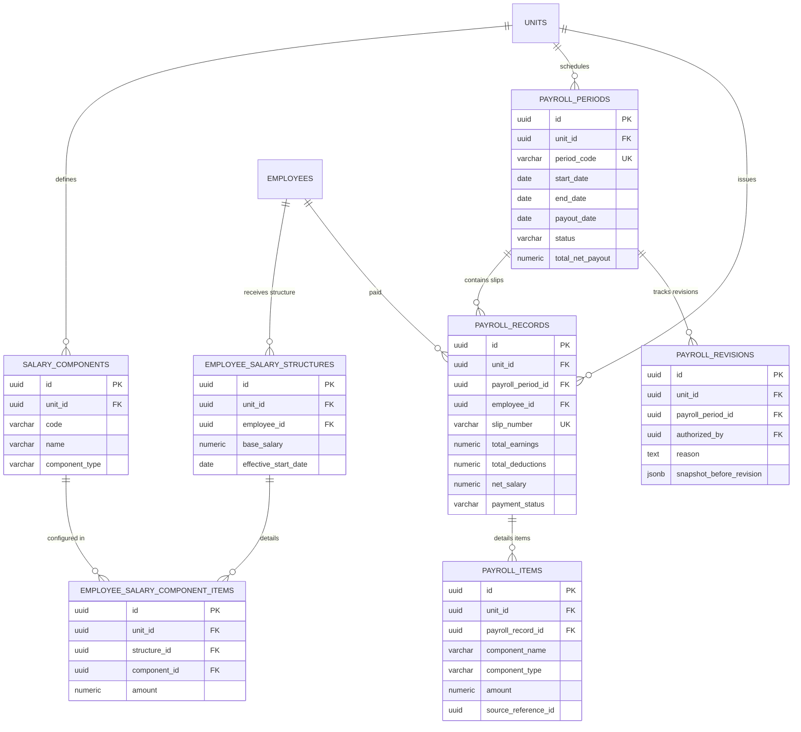
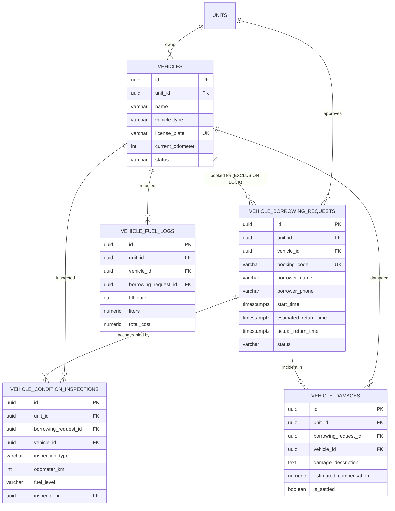
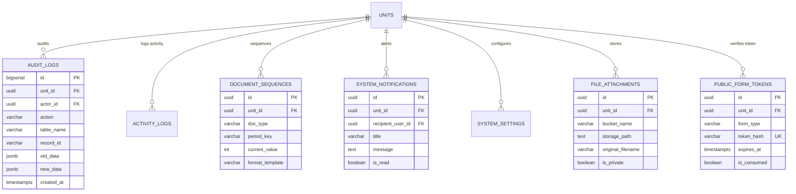

# ENTITY RELATIONSHIP DIAGRAM (ERD) — KUK MANAGEMENT SYSTEM
## Visual Domain Model & Comprehensive Relational Topology (v3.1.0)
**Versi:** 3.1.0  
**Tanggal:** 2026-11-04  
**Format Visualisasi:** Mermaid ER-Diagrams (Github-Flavored Markdown Compatible)  

---

## 1. Domain Inti: Organisasi, Multi-Unit & RBAC Multi-Role

---

## 2. Domain SDM: Master Karyawan, Keamanan Data & Riwayat Mutasi

---

## 3. Domain Cuti: Dynamic Conflict Slots & Anti-Bentrok

---

## 4. Domain Tip Pemotongan Kaca: Tip 3% Harga Kaca (CONFIRMED) & Snapshot

---

## 5. Domain Pelanggaran & Sanksi Kerja (Configurable Policy)

---

## 6. Domain Presensi: Briefing & Rekonsiliasi Fingerprint

---

## 7. Domain Penggajian: Struktur Gaji, Kalkulasi & Snapshot Final

---

## 8. Domain Armada: Peminjaman Bebas Double-Booking & Inspeksi

---

## 9. Domain Sistem: Observability, Notifikasi, Token & Dokumen

---

## 10. Matriks Kardinalitas & Kepatuhan Integritas v3.1.0

| Pasangan Relasi | Kardinalitas | Foreign Key di Schema | Proteksi Integritas Multi-Unit |
|---|:---:|---|---|
| `organizations` -> `units` | 1 to N | `departments.unit_id -> units.id` | Partisi departemen berbasis unit. |
| `units` -> `departments` | 1 to N | `departments.unit_id -> units.id` | Partisi departemen berbasis unit. |
| `units` -> `positions` | 1 to N | `positions.unit_id -> units.id` | Partisi jabatan berbasis unit. |
| `units` -> `work_schedules` | 1 to N | `work_schedules.unit_id -> units.id` | Shift kerja berbasis unit. |
| `departments` -> `employees` | 1 to N | `employees(unit_id, department_id) -> departments(unit_id, id)` | **Composite FK**: Karyawan terkunci di departemen unitnya. |
| `positions` -> `employees` | 1 to N | `employees(unit_id, position_id) -> positions(unit_id, id)` | **Composite FK**: Karyawan terkunci di jabatan unitnya. |
| `work_schedules` -> `employees` | 1 to N | `employees(unit_id, work_schedule_id) -> work_schedules(unit_id, id)` | **Composite FK**: Jadwal kerja karyawan sesuai unitnya. |
| `employees` -> `employee_sensitive_data` | 1 to 1 | `employee_sensitive_data(unit_id, employee_id) -> employees(unit_id, id)` | Pemisahan data NIK & Bank dari tabel publik. |
| `employees` -> `employee_portal_auth` | 1 to 1 | `employee_portal_auth(unit_id, employee_id) -> employees(unit_id, id)` | Pemisahan PIN mandiri dengan proteksi brute-force. |
| `employees` -> `leave_requests` | 1 to N | `leave_requests(unit_id, employee_id) -> employees(unit_id, id)` | **Composite FK**: Cuti terikat karyawan dan unitnya. |
| `leave_requests` -> `leave_conflict_slots` | 1 to N | `leave_conflict_slots(unit_id, leave_request_id) -> leave_requests(unit_id, id)` | Dynamic Slot Lock dengan partial unique index. |
| `glass_types` -> `glass_tips` | 1 to N | `glass_tips(unit_id, glass_type_id) -> glass_types(unit_id, id)` | **Composite FK**: Kaca terpotong sesuai stok unit. |
| `glass_tips` -> `payroll_periods` | N to 1 | `glass_tips(unit_id, payroll_period_id) -> payroll_periods(unit_id, id)` | **Composite FK**: Pengikatan tip ke periode payroll final. |
| `vehicles` -> `vehicle_borrowing_requests` | 1 to N | `vehicle_borrowing_requests(unit_id, vehicle_id) -> vehicles(unit_id, id)` | **Exclusion Constraint**: Anti-Double Booking mutlak. |
| `vehicle_borrowing_requests` -> `vehicle_fuel_logs` | 1 to N | `vehicle_fuel_logs(unit_id, borrowing_request_id) -> vehicle_borrowing_requests(unit_id, id)` | **Composite FK**: Asosiasi konsumsi BBM dengan booking. |
| `payroll_periods` -> `payroll_records` | 1 to N | `payroll_records(unit_id, payroll_period_id) -> payroll_periods(unit_id, id)` | **Composite FK** & Trigger pengunci status FINALIZED. |
| `payroll_records` -> `payroll_items` | 1 to N | `payroll_items(unit_id, payroll_record_id) -> payroll_records(unit_id, id)` | Rincian komponen gaji dalam slip terfinalisasi. |
