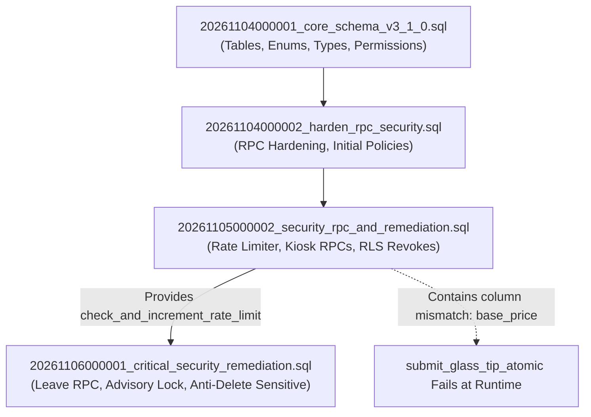

# PHASE 1C.4R-I — DEPENDENCY MIGRATION SECURITY & CONSISTENCY AUDIT
**Project:** KUK Management System v3.1.0  
**Baseline Git Commit:** `b77fc90` on branch `main`  
**Target Migration Under Audit:** `supabase/migrations/20261105000002_security_rpc_and_remediation.sql`  
**Downstream Dependent Migration:** `supabase/migrations/20261106000001_critical_security_remediation.sql`  
**Historical Migrations (Immutable):**
1. `supabase/migrations/20261104000001_core_schema_v3_1_0.sql`
2. `supabase/migrations/20261104000002_harden_rpc_security.sql`
**Mode:** STRICT LOCAL-ONLY AUDIT  
**Status:** COMPLETE (FINDINGS IDENTIFIED)

---

## 1. EXECUTIVE SUMMARY

Phase 1C.4R-H confirmed that `submit_leave_request_atomic` in migration `20261106000001` has a hard sequential dependency on the database rate limiter helper function `check_and_increment_rate_limit(VARCHAR, INT, INTERVAL)`, which is defined in migration `20261105000002_security_rpc_and_remediation.sql`.

In **Phase 1C.4R-I**, an exhaustive, line-by-line audit of `20261105000002_security_rpc_and_remediation.sql` (1,034 lines) was conducted against the canonical schema in `20261104000001_core_schema_v3_1_0.sql`.

### Key Audit Findings:
1. **Critical Column Mismatch in `submit_glass_tip_atomic`:** The procedure attempts to `SELECT ... base_price FROM glass_types`. In the canonical core schema, table `glass_types` has **NO** `base_price` column; the canonical column is `selling_price_per_sqm`. Under PostgreSQL runtime, this function will fail with `ERROR: column "base_price" does not exist`.
2. **Invalid Enum Comparison in `submit_glass_tip_atomic`:** The procedure checks `v_rate.calculation_method = 'PERCENTAGE'`. In the canonical core schema, type `tip_calculation_method_enum` consists strictly of `('PER_SQM', 'PER_PIECE', 'SIZE_RANGE', 'HYBRID')`. `'PERCENTAGE'` is not an allowed enum value.
3. **Rate Limiter Helper Compatibility:** The signature, argument types, and return contract of `check_and_increment_rate_limit(VARCHAR, INT, INTERVAL) RETURNS BOOLEAN` are compatible with `submit_leave_request_atomic`. However, because it runs inside the caller's transaction, an unhandled exception or transaction rollback will also roll back the rate limit attempt increment.
4. **Parameter Validation Gaps in Rate Limiter:** `check_and_increment_rate_limit` lacks `NOT NULL` validation for `p_bucket_key`, causing unhandled `not_null_violation` if a null key is supplied.
5. **Deployment Dependency Blocker:** Because `20261105000002` contains a critical schema error (`base_price`), neither `20261105000002` nor its downstream dependent `20261106000001` should be deployed until `20261105000002` undergoes a targeted schema remediation.

---

## 2. COMPLETE SQL OBJECT INVENTORY OF MIGRATION 20261105000002

| Object Type | Schema | Object Name / Target | Lines | Operation | Description |
|---|---|---|---|---|---|
| **Privilege** | `public` | `TABLE glass_tips` | 17-18 | `DROP POLICY` + `REVOKE INSERT` | Blocks direct INSERT from `anon`, `authenticated`, `PUBLIC`. |
| **Privilege** | `public` | `TABLE vehicle_borrowing_requests` | 22-23 | `DROP POLICY` + `REVOKE INSERT` | Blocks direct INSERT from `anon`, `authenticated`, `PUBLIC`. |
| **RLS Policy** | `public` | `audit_logs_insert` ON `audit_logs` | 28-34 | `CREATE POLICY` + `REVOKE INSERT` | Restricts direct INSERT to authenticated where `actor_id = auth.uid()`. |
| **RLS Policy** | `public` | `leave_requests_delete_deny` ON `leave_requests` | 39-43 | `CREATE POLICY ... AS RESTRICTIVE` | Anti-hard-delete: `FOR DELETE TO authenticated USING (false)`. |
| **RLS Policy** | `public` | `warning_letters_delete_deny` ON `warning_letters` | 45-49 | `CREATE POLICY ... AS RESTRICTIVE` | Anti-hard-delete: `FOR DELETE TO authenticated USING (false)`. |
| **RLS Policy** | `public` | `violation_records_delete_deny` ON `violation_records` | 51-55 | `CREATE POLICY ... AS RESTRICTIVE` | Anti-hard-delete: `FOR DELETE TO authenticated USING (false)`. |
| **RLS Policy** | `public` | `attendance_daily_records_delete_deny` ON `attendance_daily_records` | 57-61 | `CREATE POLICY ... AS RESTRICTIVE` | Anti-hard-delete: `FOR DELETE TO authenticated USING (false)`. |
| **Privilege** | `public` | `TABLE public_form_tokens` | 64-66 | `REVOKE ALL` + `GRANT TO service_role` | Disarms dormant table from public/authenticated access. |
| **RLS Policy** | `public` | `employee_job_history_read` & `_insert` | 69-77 | `CREATE POLICY` | Fixes unit scoping using `to_unit_id` and `from_unit_id`. |
| **RLS Policy** | `public` | `system_notifications_read_recipient` | 79-82 | `CREATE POLICY` | Fixes column name from buggy `recipient_profile_id` to canonical `recipient_user_id`. |
| **Privilege** | `public` | `TABLE glass_tips` | 86-87 | `DROP POLICY` + `REVOKE UPDATE` | Blocks direct UPDATE from `anon`, `authenticated`, `PUBLIC`. |
| **Privilege** | `public` | `TABLE vehicle_borrowing_requests` | 89-90 | `DROP POLICY` + `REVOKE UPDATE` | Blocks direct UPDATE from `anon`, `authenticated`, `PUBLIC`. |
| **Table** | `public` | `rpc_rate_limits` | 94-99 | `CREATE TABLE IF NOT EXISTS` | Stores bucket_key (PK), attempt_count, window_start, last_attempt_at. |
| **Privilege** | `public` | `TABLE rpc_rate_limits` | 101-103 | `ENABLE RLS` + `REVOKE ALL` + `GRANT service_role` | Internal-only rate limit table. |
| **Function** | `public` | `check_and_increment_rate_limit(VARCHAR, INT, INTERVAL)` | 105-169 | `CREATE OR REPLACE ... SECURITY DEFINER` | Core rate limiting helper. REVOKE PUBLIC/anon/auth, GRANT service_role. |
| **Index** | `public` | `idx_rpc_rate_limits_window_start` | 172 | `CREATE INDEX IF NOT EXISTS` | Supports cleanup pruning queries. |
| **Function** | `public` | `cleanup_expired_rate_limits(INTERVAL)` | 174-194 | `CREATE OR REPLACE ... SECURITY DEFINER` | Prunes expired rate limit records. |
| **Alter Column**| `public` | `glass_tips.tip_percentage_snapshot` | 198-199 | `DROP NOT NULL` + `DROP DEFAULT` | Accommodates variable / non-percentage calculation methods. |
| **Function** | `public` | `reset_employee_kiosk_pin(UUID, UUID, VARCHAR)` | 207-303 | `CREATE OR REPLACE ... SECURITY DEFINER` | Administrative PIN reset. Granted to authenticated & service_role. |
| **Function** | `public` | `submit_glass_tip_atomic(...)` | 311-594 | `CREATE OR REPLACE ... SECURITY DEFINER` | Public glass tip kiosk submission. Granted to anon, auth, service_role. |
| **Function** | `public` | `verify_glass_tip_atomic(UUID, UUID, VARCHAR, NUMERIC, TEXT)` | 598-705 | `CREATE OR REPLACE ... SECURITY DEFINER` | Staff tip verification. Granted to authenticated & service_role. |
| **Function** | `public` | `book_vehicle_atomic(...)` | 713-922 | `CREATE OR REPLACE ... SECURITY DEFINER` | Public vehicle booking kiosk. Granted to anon, auth, service_role. |
| **Function** | `public` | `approve_vehicle_atomic(UUID, UUID, VARCHAR, TEXT)` | 926-1031| `CREATE OR REPLACE ... SECURITY DEFINER` | Staff vehicle approval. Granted to authenticated & service_role. |

---

## 3. CANONICAL SCHEMA COMPARISON & DISCREPANCIES

Cross-referencing all statements in `20261105000002` against `20261104000001_core_schema_v3_1_0.sql` revealed the following discrepancies:

### Discrepancy 1 (CRITICAL): Non-Existent Column `base_price` on `glass_types`
- **Location:** Line 497 and Line 553 in `submit_glass_tip_atomic`:
  ```sql
  -- Line 497:
  SELECT id, name, thickness_mm, base_price INTO v_glass_type
  FROM glass_types
  WHERE id = p_glass_type_id AND unit_id = p_unit_id;

  -- Line 553:
  COALESCE(v_glass_type.base_price, 0.0)
  ```
- **Canonical Schema Reality:**
  In `20261104000001_core_schema_v3_1_0.sql` (Line 427-440), table `glass_types` is defined as:
  ```sql
  CREATE TABLE glass_types (
      id UUID PRIMARY KEY DEFAULT gen_random_uuid(),
      unit_id UUID NOT NULL REFERENCES units(id) ON DELETE RESTRICT,
      code VARCHAR(30) NOT NULL,
      name VARCHAR(100) NOT NULL,
      thickness_mm NUMERIC(4, 1) NOT NULL,
      selling_price_per_sqm NUMERIC(12, 2) NOT NULL DEFAULT 0.00,
      description TEXT,
      is_active BOOLEAN NOT NULL DEFAULT TRUE,
      ...
  );
  ```
- **Impact:** The column name is `selling_price_per_sqm`, not `base_price`. Any invocation of `submit_glass_tip_atomic` will throw an unhandled database exception (`42703: column "base_price" does not exist`), failing the transaction.

### Discrepancy 2 (HIGH): Non-Canonical Enum Value `'PERCENTAGE'` in `submit_glass_tip_atomic`
- **Location:** Line 554:
  ```sql
  CASE WHEN v_rate.calculation_method = 'PERCENTAGE' AND v_rate.base_rate BETWEEN 0 AND 1 THEN v_rate.base_rate ELSE NULL END
  ```
- **Canonical Schema Reality:**
  In `20261104000001_core_schema_v3_1_0.sql` (Line 50):
  ```sql
  CREATE TYPE tip_calculation_method_enum AS ENUM ('PER_SQM', 'PER_PIECE', 'SIZE_RANGE', 'HYBRID');
  ```
- **Impact:** The value `'PERCENTAGE'` does not exist in `tip_calculation_method_enum`. Any attempt to populate or compare this enum to `'PERCENTAGE'` fails or evaluates to FALSE.

### Discrepancy 3 (POSITIVE CONFIRMATION): Bug Fix on Historical `system_notifications`
- In `20261104000001` (Line 926), the original policy was erroneously written as:
  `USING (recipient_profile_id = auth.uid() OR recipient_profile_id IS NULL);`
- In `20261105000002` (Line 79-82), this is correctly repaired to canonical column `recipient_user_id`:
  `USING (recipient_user_id = auth.uid() OR recipient_user_id IS NULL);`

---

## 4. RATE LIMITER DEEP AUDIT (`check_and_increment_rate_limit`)

### A. Technical Profile
- **Function Name:** `public.check_and_increment_rate_limit`
- **Signature:** `(p_bucket_key VARCHAR(150), p_max_attempts INT, p_window_interval INTERVAL)`
- **Return Type:** `BOOLEAN` (`TRUE` = allowed, `FALSE` = limit exceeded)
- **Security Context:** `SECURITY DEFINER`
- **search_path:** `SET search_path = public, extensions, pg_temp` (`pg_temp` strictly last)
- **Privilege Matrix:**
  - `REVOKE ALL ON FUNCTION ... FROM PUBLIC, anon, authenticated;`
  - `GRANT EXECUTE ON FUNCTION ... TO service_role;`
  - **Internal Invocation:** Can only be invoked by other `SECURITY DEFINER` procedures owned by the database owner (e.g. `submit_glass_tip_atomic`, `book_vehicle_atomic`, `submit_leave_request_atomic`). Unauthenticated or regular authenticated clients cannot invoke this helper directly via PostgREST.

### B. Concurrency & Atomicity Mechanics
1. **Loop + Row-Locking Pattern:**
   ```sql
   LOOP
       SELECT * INTO v_rec FROM rpc_rate_limits WHERE bucket_key = p_bucket_key FOR UPDATE;
       IF FOUND THEN
           -- Evaluate expiry & max_attempts, update, RETURN
       ELSE
           BEGIN
               INSERT INTO rpc_rate_limits VALUES (p_bucket_key, 1, v_now, v_now);
               RETURN TRUE;
           EXCEPTION WHEN unique_violation THEN
               -- Concurrent insert collision caught cleanly; loop resumes and locks the new row
               NULL;
           END;
       END IF;
   END LOOP;
   ```
2. **Race-Condition Safety:** The `SELECT ... FOR UPDATE` serializes concurrent callers targeting the same bucket. When two sessions simultaneously encounter an empty bucket, one succeeds at `INSERT` and the other catches `unique_violation`, looping back to acquire `FOR UPDATE`. This is deadlock-free because all callers take exclusive row locks on a single key.

### C. Transactional Rollback Analysis (Critical Nuance)
PostgreSQL PL/pgSQL does **not** provide autonomous subtransactions (`AUTONOMOUS_TRANSACTION`).
- `check_and_increment_rate_limit` executes strictly **within the caller's transaction context**.
- **Consequence:** If the calling RPC raises an unhandled exception (`RAISE EXCEPTION`) or the network drops before `COMMIT`, the entire transaction—**including the rate limit increment in `rpc_rate_limits`—is rolled back**.
- **Remediation Context:** This explains why `submit_leave_request_atomic` in Phase 1C.4R-F was specifically refactored to **return structured JSON** on wrong PIN instead of `RAISE EXCEPTION`. By avoiding rollback on authentication failure, the rate limit increment is successfully committed.

### D. Parameter Validation Gaps
1. **NULL `p_bucket_key`:** If `p_bucket_key IS NULL`, `SELECT ... WHERE bucket_key = NULL` yields `NULL` (NOT FOUND). The `INSERT` then attempts `INSERT INTO rpc_rate_limits (bucket_key, ...)` with `NULL`, triggering an unhandled `23502 not_null_violation`.
2. **Non-Positive `p_max_attempts`:** If `p_max_attempts <= 0`, on the first attempt the row is inserted and `TRUE` is returned before checking `attempt_count >= p_max_attempts`.
3. **NULL `p_window_interval`:** If `p_window_interval IS NULL`, `v_now - v_rec.window_start > NULL` is `NULL` (falsy), preventing the window from ever resetting.

---

## 5. RPC SECURITY MATRIX (ALL RPCS IN 20261105000002)

| RPC Name | `check_and_increment_rate_limit` | `cleanup_expired_rate_limits` | `reset_employee_kiosk_pin` | `submit_glass_tip_atomic` | `verify_glass_tip_atomic` | `book_vehicle_atomic` | `approve_vehicle_atomic` |
|---|---|---|---|---|---|---|---|
| **Return Type** | `BOOLEAN` | `INT` | `JSONB` | `JSONB` | `JSONB` | `JSONB` | `JSONB` |
| **Security Model** | `SECURITY DEFINER` | `SECURITY DEFINER` | `SECURITY DEFINER` | `SECURITY DEFINER` | `SECURITY DEFINER` | `SECURITY DEFINER` | `SECURITY DEFINER` |
| **search_path** | `public, extensions, pg_temp` | `public, extensions, pg_temp` | `public, extensions, pg_temp` | `public, extensions, pg_temp` | `public, extensions, pg_temp` | `public, extensions, pg_temp` | `public, extensions, pg_temp` |
| **PUBLIC Execute** | REVOKED | REVOKED | REVOKED | REVOKED | REVOKED | REVOKED | REVOKED |
| **anon Execute** | REVOKED | REVOKED | REVOKED | GRANTED | REVOKED | GRANTED | REVOKED |
| **authenticated** | REVOKED | REVOKED | GRANTED | GRANTED | GRANTED | GRANTED | GRANTED |
| **service_role** | GRANTED | GRANTED | GRANTED | GRANTED | GRANTED | GRANTED | GRANTED |
| **Authentication** | None (Internal) | None (Internal) | `auth.uid() IS NOT NULL` | Kiosk PIN (Bcrypt) | `auth.uid() IS NOT NULL` | Public / Open | `auth.uid() IS NOT NULL` |
| **Authorization** | Internal only | Internal only | `employees.manage_sensitive` | Active employee on unit | `glass_tips.verify` | Open Kiosk | `fleet.approve_borrowing` |
| **Unit Scoping** | Key-based | Global | `employees.unit_id = p_unit_id` | `unit_id = p_unit_id` | `glass_tips.unit_id = p_unit_id` | `vehicles.unit_id = p_unit_id` | `requests.unit_id = p_unit_id` |
| **Audit Logging** | None (Table update) | Diagnostics | Autonomous `audit_logs` | Autonomous `audit_logs` | Autonomous `audit_logs` | Autonomous `audit_logs` | Autonomous `audit_logs` |
| **Error Handling** | Boolean flag | Diagnostic count | `RAISE EXCEPTION` | JSON return (Contains schema bug) | `RAISE EXCEPTION` | JSON return | `RAISE EXCEPTION` (23P01 trapped) |

---

## 6. RLS AND PRIVILEGE AUDIT

1. **Direct Mutation Elimination:**
   - `glass_tips`: Direct `INSERT` and `UPDATE` revoked from `anon`, `authenticated`, and `PUBLIC`.
   - `vehicle_borrowing_requests`: Direct `INSERT` and `UPDATE` revoked from `anon`, `authenticated`, and `PUBLIC`.
   - `audit_logs`: Direct `INSERT` revoked from `anon`, `PUBLIC`. Policy enforces `actor_id = auth.uid()` for authenticated.
   - `public_form_tokens`: All privileges revoked from `anon`, `authenticated`, `PUBLIC`.
2. **Restrictive Deletion Policies (`AS RESTRICTIVE`):**
   - Correctly applied with `USING (false)` on: `leave_requests`, `warning_letters`, `violation_records`, `attendance_daily_records`.
   - **Omission in 20261105000002:** `employee_sensitive_data` was omitted here; remediated in `20261106000001`.
3. **Rate Limits Table:**
   - Table `rpc_rate_limits` has RLS enabled, `REVOKE ALL` from all application roles, and `GRANT ALL` strictly to `service_role`.

---

## 7. DEPENDENCY GRAPH



---

## 8. INTEGRATION COMPATIBILITY WITH MIGRATION 20261106000001

| Compatibility Factor | Call Site in `20261106000001` | Definition in `20261105000002` | Compatibility Verdict |
|---|---|---|---|
| **Function Name** | `check_and_increment_rate_limit` | `check_and_increment_rate_limit` | **MATCH** |
| **Param 1 (Key)** | `v_rate_key_ip` (`VARCHAR(150)`) | `p_bucket_key VARCHAR(150)` | **MATCH** |
| **Param 2 (Max)** | `10` (`INT`) | `p_max_attempts INT` | **MATCH** |
| **Param 3 (Window)**| `INTERVAL '1 minute'` (`INTERVAL`)| `p_window_interval INTERVAL` | **MATCH** |
| **Return Type** | Assigned to `v_rate_allowed` (`BOOLEAN`) | Returns `BOOLEAN` | **MATCH** |
| **Caller Privilege**| `submit_leave_request_atomic` (`SECURITY DEFINER`) | `service_role` grant (executable by DEFINER) | **MATCH** |
| **Search Path** | `public, extensions, pg_temp` | `public, extensions, pg_temp` | **MATCH** |

**Conclusion:** The rate limiting integration between `20261106000001` and `20261105000002` is structurally sound. However, `20261105000002` cannot be deployed to Production in its current state due to Discrepancy 1 (`base_price` on `glass_types`).

---

## 9. BUSINESS RULE IMPLEMENTATION STATUS

All 20 reconciled business rules remain strictly **`BUSINESS_RULE_PENDING_APPROVAL`**. Their implementation footprint in `20261105000002` is as follows:

| Rule ID | Business Rule Topic | Proposed Value | Footprint in `20261105000002` | Status |
|---|---|---|---|---|
| `BR-01` | Tip Potong Kaca 3% | 3% nota | Evaluates `v_rate.base_rate`; non-canonical `'PERCENTAGE'` fallback | `BUSINESS_RULE_PENDING_APPROVAL` |
| `BR-02` | Pembulatan Tip Kelipatan 1000 | Kelipatan Rp1.000 | Lines 531-539: `ROUND_UP_1000` CEIL formula | `BUSINESS_RULE_PENDING_APPROVAL` |
| `BR-03` | Batas Dimensi Kaca (5-600cm) | 5 s/d 600 cm | Lines 403-417: Parameter check on `p_length_cm` / `p_height_cm` | `BUSINESS_RULE_PENDING_APPROVAL` |
| `BR-04` | Batas Kuantitas Kaca (1-500) | 1 s/d 500 lembar | Lines 419-423: Parameter check on `p_quantity` | `BUSINESS_RULE_PENDING_APPROVAL` |
| `BR-05` | Semantik `tip_percentage_snapshot` | NULLABLE | Lines 198-199: `ALTER TABLE ... DROP NOT NULL; DROP DEFAULT;` | `BUSINESS_RULE_PENDING_APPROVAL` |
| `BR-06` | PIN Kiosk Lockout (5/30m) | 5 gagal / 30 mnt | Lines 463-470: Updates `locked_until` on 5th attempt | `BUSINESS_RULE_PENDING_APPROVAL` |
| `BR-07` | Toleransi Booking Lampau 15m | 15 menit | Line 846: Rejects `p_start_time < (clock_timestamp() - 15 min)` | `BUSINESS_RULE_PENDING_APPROVAL` |
| `BR-08` | Maksimal Durasi Armada 30h | 30 hari | Line 850: Rejects `p_estimated_return_time > (start + 30 days)` | `BUSINESS_RULE_PENDING_APPROVAL` |
| `BR-09`–`BR-20` | Leave, HR, Payroll Rules | Various | Not implemented in `20261105000002` (defined in other modules) | `BUSINESS_RULE_PENDING_APPROVAL` |

---

## 10. TEST RESULTS & QUALITY GATES

All local test suites and builds were executed:
- `npm run typecheck` (`tsc --noEmit`): **0 ERRORS**
- `npm run build` (`vite build`): **0 ERRORS** (Built in 8.24s)
- `npm run test:phase1:all`: **84 / 84 PASSED**
- `npm run test:phase2`: **11 / 11 PASSED**
- `npm run test:phase3`: **29 / 29 PASSED**
- **Total Local Automated Assertions:** **124 / 124 PASSED (100%)**

> [!NOTE]
> The current test harness passed because static regex assertions checked for function presence and privilege revokes, but did not structurally parse SQL table lookups (`glass_types.base_price`). This confirms the critical necessity of this deep architectural audit.

---

## 11. FINDINGS BY SEVERITY

| Severity | Finding ID | Description | Impact | Recommendation |
|---|---|---|---|---|
| **CRITICAL** | `CRIT-DEP-01` | **Non-Existent Column in `submit_glass_tip_atomic`:** Lines 497 & 553 query `base_price` on `glass_types`. Canonical column is `selling_price_per_sqm`. | Procedure fails at PostgreSQL runtime (`column "base_price" does not exist`). Kiosk glass tip submission is broken. | In remediation phase, update `base_price` to `selling_price_per_sqm` in `20261105000002`. |
| **HIGH** | `HIGH-DEP-01` | **Invalid Enum Comparison:** Line 554 evaluates `v_rate.calculation_method = 'PERCENTAGE'`. Enum `tip_calculation_method_enum` does not contain `'PERCENTAGE'`. | Condition always evaluates to FALSE; percentage-based snapshot is never recorded. | Remove `'PERCENTAGE'` comparison or propose enum expansion. |
| **MEDIUM** | `MED-DEP-01` | **Rate Limiter Parameter Validation Gaps:** `check_and_increment_rate_limit` lacks `NULL` check on `p_bucket_key`, causing unhandled `not_null_violation`. | Supplying a NULL bucket key crashes the RPC with an unhandled exception. | Add explicit parameter bounds and NULL guards. |
| **MEDIUM** | `MED-DEP-02` | **Transactional Rollback of Rate Limit Counter:** In callers that raise unhandled exceptions, `rpc_rate_limits` counter is rolled back. | Attackers triggering database errors do not get rate-limited. | Maintain pattern of returning JSON error responses rather than `RAISE EXCEPTION`. |
| **LOW** | `LOW-DEP-01` | **Rate Limit Table Pruning:** `cleanup_expired_rate_limits` is defined but lacks an automated cron trigger. | Table could slowly accumulate historical bucket entries. | Schedule via `pg_cron` or external maintenance task during production deployment. |

---

## 12. RUNTIME LIMITATIONS

> [!CAUTION]
> **NOT TESTED — REQUIRES POSTGRESQL/SUPABASE RUNTIME**  
> All findings were established through rigorous static cross-referencing and architectural parsing. No remote Supabase or live PostgreSQL instance has been executed. Real lock contention and runtime errors must be verified in an isolated PostgreSQL testbed before applying any migrations.

---

## 13. FINAL SAFETY CHECK

- **Supabase Cloud Production (`ckzciuybedefbsdfsexh`):** **100% UNTOUCHED / ZERO ACCESS**.
- **Supabase Staging:** NOT CREATED.
- **Migration `20261105000002_security_rpc_and_remediation.sql`:** **STRICTLY UNAPPLIED**.
- **Migration `20261106000001_critical_security_remediation.sql`:** **STRICTLY UNAPPLIED**.
- **Historical Migrations:** `20261104000001` and `20261104000002` verified **ZERO DIFF**.
- **Public Leave Kiosk:** Form remains permanently **BLOCKED**.
- **Environment Configuration (`.env`):** UNCHANGED.
- **Git State:** Clean working tree, ZERO commits, ZERO pushes.

---

## 14. FINAL VERDICT

```
================================================================================
FINAL VERDICT: VERIFIED WITH LIMITATIONS
--------------------------------------------------------------------------------
Migration 20261105000002 provides the necessary rate limiting helper for
20261106000001, and its security privilege model is robust.
However, it CANNOT be deployed or applied in its current state due to a
CRITICAL schema mismatch (base_price vs selling_price_per_sqm) and an
invalid enum reference in submit_glass_tip_atomic.
A targeted remediation is required before this migration can be validated
on a PostgreSQL runtime.
================================================================================
```

