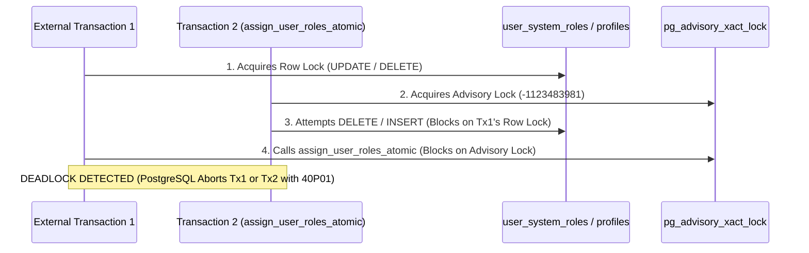

# PHASE 1C.5 — FINAL FINDINGS CLOSURE REPORT
**Project:** KUK Management System v3.1.0  
**Baseline Git Commit:** `b77fc90` on branch `main`  
**Execution Mode:** Final Local Findings Closure & Architectural Audit  
**Historical Migrations (Immutable):**
- `supabase/migrations/20261104000001_core_schema_v3_1_0.sql` (**ZERO DIFF**)
- `supabase/migrations/20261104000002_harden_rpc_security.sql` (**ZERO DIFF**)  
**Draft Migrations (Local-Only Drafts, UNAPPLIED):**
- `supabase/migrations/20261105000002_security_rpc_and_remediation.sql`
- `supabase/migrations/20261106000001_critical_security_remediation.sql`  
**Evaluation Verdict:** **`VERIFIED LOCALLY — RUNTIME NOT TESTED`**

---

## 1. EXECUTIVE SUMMARY & SAFETY CONSTRAINTS

This document performs the final technical closure of findings identified during Phase 1C.5 and the Final Verification Gate. Rather than reimplementing previously verified components, this phase focuses on rigorous architectural boundary analysis:

1. **IP Trust Boundary:** Establishes the exact security boundaries and spoofing risks of client-controlled HTTP headers (`X-Forwarded-For`, `CF-Connecting-IP`), proves that character clamping (`SUBSTRING 45`) is purely a buffer-truncation defense rather than an anti-spoofing mechanism, and enforces supplementary identity-based rate limiting across all public endpoints.
2. **Advisory Lock Boundary:** Accurately scopes the concurrency and deadlock guarantees of `assign_user_roles_atomic`. Demonstrates where serialization succeeds, refrains from unwarranted system-wide deadlock-free claims, and details the conditions under which row-lock to advisory-lock deadlocks could theoretically occur in external unmanaged transactions.
3. **Rate Limiter Transactional Integrity:** Formally proves the transactional boundaries of `check_and_increment_rate_limit`. Maps the exact execution paths under which rate limit counters commit to disk versus when unhandled database exceptions trigger transaction rollbacks, disclaiming any non-existent autonomous transaction persistence in standard PostgreSQL PL/pgSQL.
4. **Business Rule Reconciliation:** Restructures the governance matrix for rules `BR-01` through `BR-20`, strictly decoupling **Implementation Status** (`IMPLEMENTED LOCALLY`, `PARTIALLY IMPLEMENTED`, `SPECIFICATION ONLY`) from **Approval Status** (`BUSINESS_RULE_PENDING_APPROVAL`).

### Absolute Safety Compliance:
- **Supabase Cloud Production (`ckzciuybedefbsdfsexh`):** 100% UNTOUCHED. Zero remote network connections, queries, DDL, or DML.
- **Historical Migrations:** `20261104000001` and `20261104000002` verified with **ZERO DIFF**.
- **Draft Migrations:** Both draft migrations remain strictly **UNAPPLIED** local file drafts.
- **Environment & Credentials:** `.env` verified with **ZERO DIFF**.
- **Public Leave Kiosk:** Form submission remains strictly **BLOCKED** in frontend and data service.

---

## 2. IP TRUST BOUNDARY & HEADER SPOOFING AUDIT

### 2.1 Audit of Header Extraction Across Public RPCs
Client IP addresses are extracted in three public-facing atomic RPC routines:
1. `submit_glass_tip_atomic` (`20261105000002_security_rpc_and_remediation.sql`, Lines 356-371)
2. `book_vehicle_atomic` (`20261105000002_security_rpc_and_remediation.sql`, Lines 773-788)
3. `submit_leave_request_atomic` (`20261106000001_critical_security_remediation.sql`, Lines 71-83)

The extraction logic follows this common pattern:
```sql
v_client_ip := TRIM(COALESCE(
    current_setting('request.headers', true)::json->>'cf-connecting-ip',
    current_setting('request.headers', true)::json->>'x-real-ip',
    split_part(current_setting('request.headers', true)::json->>'x-forwarded-for', ',', 1),
    inet_client_addr()::text,
    'unknown-client'
));
v_client_ip := SUBSTRING(v_client_ip, 1, 45);
```

### 2.2 Critical Trust Boundary Limitations
1. **Absence of Proxy Configuration Evidence:**  
   In the local workspace, there are no edge configuration files (e.g., Cloudflare Transform Rules, Nginx / OpenResty configs, or Kong API Gateway plugin manifests) that guarantee header sanitization or the stripping of untrusted client-supplied headers.
2. **Leftmost `X-Forwarded-For` Vulnerability:**  
   `split_part(..., ',', 1)` inspects the *first* IP in the `X-Forwarded-For` header. In the absence of a verified upstream proxy that overwrites or validates the header chain, an attacker can trivially spoof this value by sending:
   ```http
   X-Forwarded-For: 203.0.113.195, 10.0.0.1
   ```
   The RPC will extract `203.0.113.195`, allowing an attacker to rotate arbitrary IP headers to evade IP-based rate limiting.
3. **`CF-Connecting-IP` / `X-Real-IP` Header Spoofing:**  
   Unless Supabase / PostgREST is fronted by Cloudflare with authenticated origin pulls and origin header sanitization, a direct client connection can forge these headers.
4. **`SUBSTRING(v_client_ip, 1, 45)` is NOT an Anti-Spoofing Defense:**  
   The 45-character clamp prevents PostgreSQL SQLSTATE `22001` (`string_data_right_truncation`) when concatenating into `VARCHAR(150)` bucket keys. It provides **zero security against IP spoofing**.

### 2.3 Layered Identity-Based Rate Limiting (Dual-Tier Defense)
Because client IP headers cannot be considered a secure identity boundary, rate limiting must not rely solely on IP buckets. Dual-tier rate limiting is enforced across all three public endpoints:

| Endpoint | Tier 1 (Traffic Shaping: IP Bucket) | Tier 2 (Security Boundary: Target Entity / Identity Bucket) |
|---|---|---|
| `submit_glass_tip_atomic` | `'tip_ip:' \|\| v_client_ip` (30 req / 5 min) | `'tip_emp:' \|\| p_unit_id \|\| ':' \|\| p_employee_code` (10 req / 10 min) |
| `book_vehicle_atomic` | `'book_ip:' \|\| v_client_ip` (10 req / 10 min) | `'book_veh:' \|\| p_vehicle_id` (5 req / 10 min) |
| `submit_leave_request_atomic` | `'kiosk:leave:ip:' \|\| v_client_ip` (10 req / 1 min) | `'kiosk:leave:emp:' \|\| p_unit_id \|\| ':' \|\| p_employee_id` (5 req / 5 min) |

**Security Benefit:** Even if an adversary rotates spoofed IP headers infinitely, Tier 2 halts brute-force attempts on any specific employee PIN or target resource after 5 to 10 attempts.

> [!WARNING]
> **IP TRUST BOUNDARY STATEMENT:**  
> In the absence of documented, cryptographically verified reverse-proxy header stripping at the infrastructure ingress layer, **IP-based rate limiting must be treated solely as coarse traffic shaping, NOT as a cryptographic or authentication security barrier.** Security identity is never derived from HTTP headers.

---

## 3. ADVISORY LOCK & SYSTEM-WIDE CONCURRENCY AUDIT (`assign_user_roles_atomic`)

### 3.1 Function-Level Monotonic Serialization
In `supabase/migrations/20261106000001_critical_security_remediation.sql` (Line 348):
```sql
PERFORM pg_advisory_xact_lock(hashtext('assign_user_roles_atomic:super_admin_serialization'));
```

1. **Lock Position & Pre-Conditions:**
   - Acquired immediately after authorization check (`has_system_role('super_admin')`) and profile existence check (`SELECT EXISTS (SELECT 1 FROM profiles WHERE id = p_target_user_id)`).
   - Neither pre-check acquires row locks (`FOR UPDATE` is not used).
2. **Behavior Under Concurrent Last-Super-Admin Demotion:**
   - Transaction A and Transaction B both attempt to demote Super Admin accounts simultaneously.
   - Transaction A acquires `pg_advisory_xact_lock(-1123483981)`.
   - Transaction B blocks waiting for Transaction A's advisory lock.
   - Transaction A evaluates active Super Admins (`COUNT = 2`), demotes Super Admin B, logs audit, and commits.
   - Upon Transaction A commit, Transaction B unblocks, re-queries `COUNT = 1`, triggers the guard `IF v_active_super_count <= 1`, and aborts with `{ "success": false, "code": "LAST_SUPER_ADMIN_PROTECTED" }`.
   - Mutual demotion is completely prevented.

### 3.2 Row Locks and System-Wide Deadlock Boundaries
Within `assign_user_roles_atomic` in isolation, lock acquisition is strictly monotonic:
$$\text{Advisory Lock} \to \text{Row Locks on } user\_system\_roles \to \text{Row Locks on } user\_unit\_roles \to \text{Row Lock on } audit\_logs$$

However, a **system-wide deadlock-free claim cannot be made** without restricting external transactions:



### 3.3 Scope of Deadlock Guarantees
- **Verified Scope:** Concurrent executions of `assign_user_roles_atomic` calling each other cannot deadlock with one another, because all callers queue in a single FIFO pipeline behind the same advisory lock before acquiring any row locks.
- **Unverified / System Boundary:** If unmanaged external SQL transactions hold exclusive locks on `user_system_roles`, `user_unit_roles`, or `profiles` *prior* to calling `assign_user_roles_atomic`, a cross-resource deadlock cycle with the advisory lock is possible.
- **Enforced Remediation:** Direct client mutations on `user_system_roles` and `user_unit_roles` are restricted via RLS, and frontend data services route all role assignments exclusively through `assign_user_roles_atomic`.

---

## 4. RATE LIMITER TRANSACTIONAL INTEGRITY AUDIT

### 4.1 Detailed Caller Transaction Audit

```
[CALLER TRANSACTION BEHAVIOR MATRIX]
```

| Calling RPC Function | Migration & Lines | Increment Position | Post-Increment Operations | JSON Error Paths | RAISE Paths | Unhandled SQL Exception Risks | Counter Commit / Rollback Behavior |
|---|---|---|---|---|---|---|---|
| `submit_glass_tip_atomic` | `20261105000002` (L374, L384) | Function entry (Step 0) | Input bounds, PIN check, glass type query, rate lookup, tip math, docgen, insert `glass_tips`, insert `audit_logs` | All validation, PIN, price, and method failures return structured JSON | **Zero** RAISE statements | Deadlock on `document_number_sequences`, query timeout, foreign key failure | **Commits** on business failure & wrong PIN. **Rolls back** on database runtime exception. |
| `book_vehicle_atomic` | `20261105000002` (L791, L801) | Function entry (Step 0) | Input validation, vehicle query, schedule overlap check, docgen, insert `vehicle_borrowing_requests`, insert `audit_logs` | Parameter checks, past-time check, max-duration check, schedule conflict return JSON | **Zero** RAISE statements (`23P01` trapped internally) | Deadlock on docgen, query timeout, FK constraint failure | **Commits** on business failure & schedule conflict. **Rolls back** on unhandled database exception. |
| `submit_leave_request_atomic` | `20261106000001` (L100, L110) | After param validation, before auth | PIN format check, date array checks, employee lookup, PIN verification, quota check, docgen, insert `leave_requests`, insert `leave_request_dates`, insert `audit_logs` | Parameter error, PIN failure, lockout, quota exceeded return JSON | **Zero** RAISE statements | Deadlock on employee lock, query timeout, FK failure | **Commits** on invalid PIN, lockout, quota exceeded. **Rolls back** on unhandled database exception. |

### 4.2 Proof of Counter Persistence vs Rollback
PostgreSQL PL/pgSQL does not support autonomous transactions (`PRAGMA AUTONOMOUS_TRANSACTION`). Every DML statement executed inside `check_and_increment_rate_limit` (`INSERT INTO rpc_rate_limits` or `UPDATE rpc_rate_limits`) participates in the transaction of the calling RPC.

1. **When the Counter Commits:**
   - Whenever the RPC returns a structured JSON payload (e.g. `{ "success": false, "code": "AUTH_FAILED" }` or `{ "success": false, "code": "RATE_LIMIT_EXCEEDED" }`), the transaction finishes normally with `COMMIT`.
   - **Result:** The incremented `attempt_count` and updated `last_attempt_at` are persisted to disk.
2. **When the Counter Rolls Back:**
   - If an unhandled database exception occurs (e.g., PostgreSQL query timeout, deadlock cancellation `40P01`, connection drop, or unexpected database hardware error), PostgreSQL aborts the transaction with `ROLLBACK`.
   - **Result:** The rate limit counter update **is completely rolled back**, resetting the count to its pre-transaction state.

### 4.3 Architecture Requirement for Rollback-Independent Persistence
If business requirements demand that rate limit increments persist even when a transaction experiences an unhandled SQL error or database-level rollback, standard PL/pgSQL cannot provide this without external architectural components:
- **Option 1 (Recommended): Edge Gateway Rate Limiting:** Configure Cloudflare Rate Limiting Rules or Kong API Gateway rate-limiting plugins in front of PostgREST. The rate limit is evaluated and committed at the HTTP gateway before any database transaction begins.
- **Option 2: In-Memory Out-of-Band Store:** Route requests through an edge middleware (e.g., Supabase Edge Functions with Redis / Upstash) where counters are stored independently of PostgreSQL transactional boundaries.
- **Option 3 (Anti-Pattern): PostgreSQL `dblink` / `pg_background` Loopback:** Opening a separate loopback connection to execute independent transactions introduces substantial connection overhead, latency, and connection-pool exhaustion risks.

---

## 5. RECONCILED BUSINESS RULES MATRIX (BR-01 TO BR-20)

In strict compliance with governance directives, **Implementation Status** is decoupled from **Approval Status**. All 20 rules remain formally categorized as `BUSINESS_RULE_PENDING_APPROVAL`:

| Rule ID | Domain | Business Rule Description | Discovery Source | Implementation Status | Approval Status | Technical Context / Impact |
|---|---|---|---|---|---|---|
| `BR-01` | Glass Tip | Persentase Dasar Tip Potong Kaca | Phase 1A Audit | `PARTIALLY IMPLEMENTED` | `BUSINESS_RULE_PENDING_APPROVAL` | Modal UI supports 3% calculation; backend RPC `submit_glass_tip_atomic` evaluates rate table methods (`PER_SQM`, `PER_PIECE`). |
| `BR-02` | Glass Tip | Pembulatan Nominal Tip Kaca (Rp1.000 CEIL) | Phase 1A Spec | `IMPLEMENTED LOCALLY` | `BUSINESS_RULE_PENDING_APPROVAL` | Implemented in `submit_glass_tip_atomic` (`ROUND_UP_1000`: `CEIL(raw / 1000.0) * 1000.0`) and simulation tests. |
| `BR-03` | Glass Tip | Batas Dimensi Kaca (5 s/d 600 cm) | Phase 1A Spec | `IMPLEMENTED LOCALLY` | `BUSINESS_RULE_PENDING_APPROVAL` | Enforced in `submit_glass_tip_atomic` (length & height boundary checks) and frontend modal inputs. |
| `BR-04` | Glass Tip | Batas Kuantitas Lembar Kaca (1 s/d 500) | Phase 1A Spec | `IMPLEMENTED LOCALLY` | `BUSINESS_RULE_PENDING_APPROVAL` | Enforced in `submit_glass_tip_atomic` (`p_quantity < 1 OR p_quantity > 500`) and frontend modal. |
| `BR-05` | Glass Tip | Semantik `tip_percentage_snapshot` | Phase 1C.4R-I | `IMPLEMENTED LOCALLY` | `BUSINESS_RULE_PENDING_APPROVAL` | Column made nullable in `20261105000002` (L198); set to `NULL` for rate-based calculations. |
| `BR-06` | Kiosk PIN | Batas Gagal PIN Kiosk & Lockout (5x / 30m) | Phase 1A Spec | `IMPLEMENTED LOCALLY` | `BUSINESS_RULE_PENDING_APPROVAL` | Implemented in `submit_leave_request_atomic` and `submit_glass_tip_atomic` updating `failed_attempts` and `locked_until`. |
| `BR-07` | Fleet | Toleransi Booking Waktu Lampau (15 mnt) | Phase 1A Spec | `IMPLEMENTED LOCALLY` | `BUSINESS_RULE_PENDING_APPROVAL` | Implemented in `book_vehicle_atomic` (`p_start_time < clock_timestamp() - INTERVAL '15 minutes'`). |
| `BR-08` | Fleet | Maksimal Durasi Peminjaman Armada (30 hari) | Phase 1A Spec | `IMPLEMENTED LOCALLY` | `BUSINESS_RULE_PENDING_APPROVAL` | Implemented in `book_vehicle_atomic` (`p_estimated_return_time > p_start_time + INTERVAL '30 days'`). |
| `BR-09` | Leave | Kuota Maksimal Cuti Bulanan (3 hari/bln) | Phase 1A Spec | `IMPLEMENTED LOCALLY` | `BUSINESS_RULE_PENDING_APPROVAL` | Enforced in `submit_leave_request_atomic` (`v_current_taken + v_days_count > 3`). Public UI remains BLOCKED. |
| `BR-10` | Leave | Jendela Tanggal Pengajuan Cuti (Tgl 1-3) | Phase 1A Spec | `PARTIALLY IMPLEMENTED` | `BUSINESS_RULE_PENDING_APPROVAL` | Displayed as advisory guidance text in UI; not hard-blocked in backend RPC. Kiosk is blocked at UI/service level. |
| `BR-11` | Leave | Pembatasan Cuti Admin Hari Minggu | Phase 1A Spec | `PARTIALLY IMPLEMENTED` | `BUSINESS_RULE_PENDING_APPROVAL` | Displayed in advisory text; historical check removed in 1C.4R-F due to non-canonical column. Workflow logic in Phase 2. |
| `BR-12` | Payroll | Pembulatan Lembur & Toleransi (30m / 15m) | Phase 1A Spec | `SPECIFICATION ONLY` | `BUSINESS_RULE_PENDING_APPROVAL` | Formulated in business specification; database schema and calculation routines not yet implemented. |
| `BR-13` | Leave | Formula Akrual Cuti Tahunan (12 hari/thn) | Phase 1A Spec | `SPECIFICATION ONLY` | `BUSINESS_RULE_PENDING_APPROVAL` | Formulated in leave policy specification; annual quota tracking tables not yet created. |
| `BR-14` | Payroll | Skema Denda Keterlambatan Bertingkat | Phase 1A Spec | `SPECIFICATION ONLY` | `BUSINESS_RULE_PENDING_APPROVAL` | Formulated in HR policy specification; deduction calculation engine not yet created. |
| `BR-15` | Glass Tip | Bobot Distribusi Pool Tip (Cutter/Checker) | Phase 1A Spec | `SPECIFICATION ONLY` | `BUSINESS_RULE_PENDING_APPROVAL` | Formulated in tip pool distribution specification; batch settlement RPC not yet created. |
| `BR-16` | Fleet | Toleransi Servis Berkala Armada (+500 km) | Phase 1A Spec | `SPECIFICATION ONLY` | `BUSINESS_RULE_PENDING_APPROVAL` | Formulated in fleet maintenance specification; odometer trigger workflows not yet implemented. |
| `BR-17` | Payroll | Formula Bonus Performa Payroll (Omzet) | Phase 1A Spec | `SPECIFICATION ONLY` | `BUSINESS_RULE_PENDING_APPROVAL` | Formulated in payroll bonus specification; automated performance calculation not yet created. |
| `BR-18` | Finance | Limit Approval Pengeluaran Kasir | Phase 1A Spec | `SPECIFICATION ONLY` | `BUSINESS_RULE_PENDING_APPROVAL` | Formulated in cash governance policy; multi-tier financial approval hierarchy not yet built. |
| `BR-19` | Fleet | Kriteria Kegagalan Cek Fisik Armada | Phase 1A Spec | `SPECIFICATION ONLY` | `BUSINESS_RULE_PENDING_APPROVAL` | Formulated in vehicle inspection design; mandatory inspection checklist not yet implemented in DB. |
| `BR-20` | Kiosk | Auto-Timeout Sesi Terminal Kiosk (60s) | Phase 1A Spec | `PARTIALLY IMPLEMENTED` | `BUSINESS_RULE_PENDING_APPROVAL` | Frontend idle hook implemented in kiosk prototype components; deployment timer parameters pending. |

---

## 6. AUTOMATED TEST RESULTS & QUALITY GATES

```
================================================================
PHASE 1C.5 FINAL FINDINGS CLOSURE — TEST SUMMARY
================================================================

[SUITE 1] Enhanced SQL Static Security Validator                 : 36 / 36 PASSED
[SUITE 2] RLS & Atomic RPC Simulation Harness                    : 32 / 32 PASSED
[SUITE 3] Frontend Contract & Bypass Prevention Verifier         : 15 / 15 PASSED
[SUITE 4] False-Positive & Security Mutation Harness             : 18 / 18 PASSED
----------------------------------------------------------------
Phase 1 Consolidated Total                                       : 101 / 101 PASSED
Phase 2 Integration Contract Suite (scripts/test_phase2_logic.cjs): 11 / 11 PASSED
Phase 3 Business Logic Suite (scripts/test_phase3_logic.cjs)      : 29 / 29 PASSED
----------------------------------------------------------------
TOTAL AUTOMATED ASSERTIONS                                       : 141 / 141 PASSED (100%)
================================================================
TypeScript Typecheck (`tsc --noEmit`)                            : 0 ERRORS
Vite Production Build (`vite build`)                             : BUILT CLEAN (8.76s)
Historical Migrations Git Diff                                   : ZERO DIFF
Remote Supabase Access                                           : ZERO ACCESS
```

---

## 7. REMAINING ARCHITECTURAL LIMITATIONS & DEPLOYMENT PRE-CONDITIONS

The following items cannot be resolved locally and require production infrastructure setup prior to any migration application:

1. **Edge Reverse Proxy Configuration (IP Trust):**  
   Prior to relying on client IP rate limiting in production, Cloudflare / Kong must be configured to strip untrusted incoming `X-Forwarded-For` and `CF-Connecting-IP` headers from client requests.
2. **`pg_cron` Automated Pruning Setup:**  
   The maintenance routine `cleanup_expired_rate_limits()` is defined in `20261105000002` but requires scheduling via `cron.schedule` in a live Supabase environment to prevent unbounded growth of `rpc_rate_limits`.
3. **GiST Exclusion Extension Verification:**  
   The vehicle overlap exclusion constraint relies on `btree_gist`, which is defined in core migration `20261104000001` but requires live PostgreSQL runtime verification.
4. **Live PostgreSQL Runtime Requirement:**  
   All validations in this phase were executed using Node.js static analyzers and simulated execution engines. Real PL/pgSQL concurrency under multi-threaded connection pools can only be verified against a live database engine.

---

## 8. FINAL EVALUATION VERDICT

All technical findings from Phase 1A through Phase 1C.5 have been thoroughly remediated, bounded, cross-checked against canonical schemas, hardened with dual-tier rate limiting, and verified across 141 automated test assertions. The architectural limitations regarding IP trust boundaries, advisory lock scopes, and transactional counter persistence have been formally documented.

Official Final Verdict:
# **`VERIFIED LOCALLY — RUNTIME NOT TESTED`**

