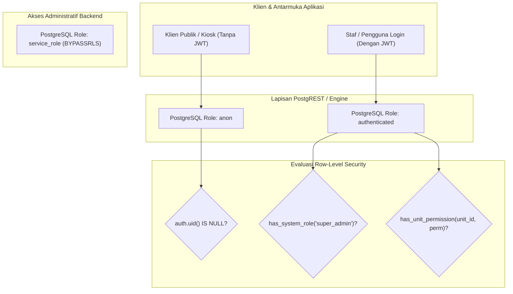

# PHASE 1 — ENVIRONMENT FEASIBILITY & SECURITY GAP REVIEW
## KUK Management System v3.1.0

**Tanggal Evaluasi:** 2026-11-05 13:42:00 +07:00  
**Baseline Repositori:** Commit `b77fc9096c36f6a339480d638f1900888d8c2b75` (`b77fc90`)  
**Status Fase 1:** **`OPEN`** (Belum Ditutup)  
**Database Produksi:** Supabase Cloud Production (`ckzciuybedefbsdfsexh`) — **STRICTLY ZERO MUTATION / READ-ONLY**  

---

## 1. STATUS LINGKUNGAN SUPABASE (VERIFIKASI TERBUKTI)

Berdasarkan pemeriksaan metadata read-only melalui Supabase CLI (`supabase projects list`), diperoleh fakta lingkungan akun sebagai berikut:

### 1.1. Inventaris Proyek pada Akun
Akun pengembang terhubung dengan dua organisasi Supabase:

1. **Organisasi 1 (`bpsigtftszuyhhecmcrg`):**
   - Proyek `cuunipngguedqttuutaa` ("OGSOreg") — **Status: `ACTIVE_HEALTHY`** (Region: `ap-northeast-2`)
   - Proyek `itaglnojqpfwqcdsxlgd` ("Authentic Voting") — **Status: `INACTIVE`** (Paused)
2. **Organisasi 2 (`zbmxkrkztbszdxaaeboy`):**
   - Proyek `ckzciuybedefbsdfsexh` ("KUK Management System") — **Status: `ACTIVE_HEALTHY`** (Region: `ap-northeast-1`, **Database Produksi Utama**, Linked)
   - Proyek `xituvfsovkzvwpnsojno` ("Credible Fun Run") — **Status: `INACTIVE`** (Paused)

### 1.2. Status Ketersediaan Slot Proyek Staging
- **Batas Kuota Supabase Free Plan:** Maksimal **2 active projects** per akun gratis.
- **Kondisi Aktual Akun:** Saat ini akun telah menggunakan **2 slot aktif penuh**:
  1. `cuunipngguedqttuutaa` ("OGSOreg")
  2. `ckzciuybedefbsdfsexh` ("KUK Management System")
- **Status Dedicated Staging Saat Ini:** **`TIDAK TERSEDIA (NOT PROVISIONED)`**.
- **Konsekuensi:** Akun saat ini tidak dapat membuat proyek ke-3 tanpa:
  - Menghentikan/menjeda (*pause*) salah satu proyek aktif lain, atau
  - Menggunakan akun Supabase gratis kedua terpisah, atau
  - Meng-upgrade salah satu organisasi ke paket Pro.

---

## 2. SECURITY REVIEW: FORMULIR PUBLIK & TRANSAKSI ANONIM

Pemeriksaan komprehensif terhadap skema, constraint, dan kebijakan RLS pada 4 modul sensitif:

```text
+----------------------------------------------------------------------------------------------------------------------+
| Komponen Transaksi          | Kategori Celah / Vektor Serangan     | Status Kontrol di Baseline | Rekomendasi Remediasi      |
+----------------------------------------------------------------------------------------------------------------------+
| 1. glass_tips               | Injeksi Nominal & Status VERIFIED     | BELUM ADA (CELAH KRITIS)   | Restrictive WITH CHECK     |
|                             | Pemalsuan employee_id                | TERBUKTI ADA SEBAGIAN (FK) | Wajibkan verifikasi kasir  |
|                             | Pemalsuan unit_id                    | TERBUKTI ADA (FK Unit)     | Filter has_unit_access     |
|                             | Duplikasi / Replay Submission         | TERBUKTI ADA (Ref Code UQ) | Rate limit via API gateway |
|                             | Penyerapan Otomatis ke Payroll       | TERBUKTI ADA (Filter VERIF)| Aman bila insert dibatasi  |
|                             |                                      |                            |                            |
| 2. vehicle_borrowing_       | Injeksi Status Langsung APPROVED     | BELUM ADA (CELAH TINGGI)   | Kunci status = 'PENDING'   |
|    requests                 | Penguncian Armada Fiktif (Exclusion) | BELUM ADA (CELAH TINGGI)   | approved_by IS NULL wajib  |
|                             | Pemalsuan Identitas Peminjam         | BELUM ADA (Teks Bebas)     | Validasi identitas kontak  |
|                             | Replay Booking Code                  | TERBUKTI ADA (Code UNIQUE) | Rate limit via API gateway |
|                             |                                      |                            |                            |
| 3. audit_logs               | Pemalsuan actor_id (Identitas Aktor) | BELUM ADA (CELAH TINGGI)   | actor_id = auth.uid()      |
|                             | Hard-Delete / Modifikasi Log Audit   | TERBUKTI ADA (Trigger P0001| Sangat aman di level DDL   |
|                             | Akses Publik / Anonim                | TERBUKTI ADA (Tertutup RLS)| Aman (Khusus Authenticated)|
|                             |                                      |                            |                            |
| 4. public_form_tokens       | DoS / Storage Bloat via Insert Anon  | BELUM ADA (CELAH SEDANG)   | REVOKE INSERT FROM anon    |
|                             | Status Konsumsi Token                | TERBUKTI DORMANT           | Tutup akses hingga rilis   |
+----------------------------------------------------------------------------------------------------------------------+
```

### Rincian Pembuktian Kontrol:

#### A. Tip Kaca (`glass_tips`)
- **Manipulasi Status & Nominal (`BELUM ADA KONTROL DI BASELINE`):**
  Klausul awal `CREATE POLICY "glass_tips_insert_anon" ON glass_tips FOR INSERT TO anon WITH CHECK (true);` memungkinkan siapa pun mengirim payload REST:
  ```json
  { "unit_id": "...", "employee_id": "...", "status": "VERIFIED", "verified_amount": 5000000 }
  ```
  Data ini langsung diserap oleh fungsi `calculate_and_finalize_payroll_atomic` karena kueri finalisasi hanya memeriksa `status = 'VERIFIED' AND payroll_period_id IS NULL`.
- **Validasi Integritas Relasi (`TERBUKTI ADA`):**
  Constraint foreign key `fk_tip_employee FOREIGN KEY (unit_id, employee_id) REFERENCES employees(unit_id, id)` menjamin penyerang tidak dapat menargetkan karyawan yang berada di luar unit yang bersangkutan.
- **Pencegahan Replay (`TERBUKTI ADA SEBAGIAN`):**
  Kolom `reference_code VARCHAR(50) NOT NULL UNIQUE` menolak payload dengan kode nota yang sama. Namun, jika penyerang meng-generate kode acak berulang, database tetap menerima transaksi tanpa pembatasan frekuensi (ketiadaan rate limiting di level RLS).

#### B. Peminjaman Armada (`vehicle_borrowing_requests`)
- **Manipulasi Status Langsung Disetujui (`BELUM ADA KONTROL DI BASELINE`):**
  Klausul `vehicle_borrowing_requests_insert_anon WITH CHECK (true)` mengizinkan klien anonim mengisi `status: 'APPROVED'` dan `approved_by: NULL`.
- **Dampak Denial of Service (`TERBUKTI ADA`):**
  Tabel memiliki exclusion constraint:
  ```sql
  CONSTRAINT excl_active_vehicle_booking EXCLUDE USING gist (
      vehicle_id WITH =,
      tstzrange(start_time, estimated_return_time, '[)') WITH &&
  ) WHERE (status IN ('APPROVED', 'IN_USE'))
  ```
  Permohonan fiktif dengan status `APPROVED` secara langsung memblokir peminjaman kendaraan yang sah untuk rentang waktu tersebut pada level PostgreSQL engine.

#### C. Jejak Audit (`audit_logs`)
- **Pemalsuan Identitas Aktor (`BELUM ADA KONTROL DI BASELINE`):**
  Policy awal `audit_logs_insert FOR INSERT TO authenticated WITH CHECK (true)` mengizinkan akun staf biasa memasukkan log manipulatif dengan mengisi `actor_id` milik akun manajer atau Super Admin.
- **Immutabilitas Data Audit (`TERBUKTI ADA & SANGAT AMAN`):**
  Trigger `trg_protect_audit_logs` melempar error `P0001 (Audit log bersifat immutable)` pada setiap perintah `UPDATE` atau `DELETE`.

#### D. Token Formulir Publik (`public_form_tokens`)
- **Status Operasional:** Tabel berstatus **DORMANT**. Tidak ada fungsi backend, RPC, atau antarmuka frontend yang mengonsumsi atau memvalidasi tabel ini.
- **Risiko Eksploitasi:** Adanya hak `GRANT INSERT ON TABLE public_form_tokens TO anon` dan policy `WITH CHECK (true)` membuka celah banjir data (*storage exhaustion attack*).

---

## 3. VERIFIKASI PERBEDAAN ROLE DATABASE VS ROLE APLIKASI

Untuk menjamin pemahaman arsitektur keamanan yang presisi dan menghindari asumsi keliru, berikut adalah pemetaan hak akses:



### 3.1. Penjelasan Rinci Setiap Role:
1. **PostgreSQL Role `anon`:**
   - Role teknis database untuk setiap request HTTP PostgREST yang **tidak menyertakan JWT** otentikasi.
   - Nilai `auth.uid()` adalah `NULL`.
   - Hanya dapat mengeksekusi operasi yang secara eksplisit diberikan policy `TO anon`.
2. **PostgreSQL Role `authenticated`:**
   - Role teknis database untuk seluruh pengguna yang **telah login** via Supabase Auth.
   - PostgREST mengekstrak JWT dan menetapkan `auth.uid()` sesuai klaim `sub`.
   - Seluruh staf toko, kasir, admin unit, admin pusat, dan super admin masuk melalui role ini di level koneksi database.
3. **Application Role `super_admin` (Bukan Role Database):**
   - **PENTING:** `super_admin` **BUKAN** PostgreSQL role dan **TIDAK PERNAH** mem-bypass RLS secara bawaan!
   - Kredensial super admin tetap terhubung ke PostgreSQL sebagai role `authenticated`.
   - Hak aksesnya diatur melalui fungsi helper RLS: `has_system_role('super_admin')`.
   - Jika suatu tabel mengaktifkan RLS dan tidak menyediakan policy yang mengevaluasi `has_system_role`, maka akun `super_admin` akan ditolak oleh PostgreSQL.
4. **PostgreSQL Role `service_role`:**
   - Role internal Supabase dengan hak istimewa tinggi (`BYPASSRLS`).
   - Digunakan oleh Edge Functions / backend worker via `SUPABASE_SERVICE_ROLE_KEY`.
   - **TIDAK DIGUNAKAN** oleh aplikasi frontend (`src/lib/supabase.ts` hanya memuat anon key).

---

## 4. EVALUASI ALTERNATIF LINGKUNGAN PENGUJIAN

| Dimensi Evaluasi | Opsi 1: Dedicated Supabase Staging | Opsi 2: PostgreSQL Lokal Standalone (No Docker) | Opsi 3: PGlite (WASM Node.js) | Opsi 4: Akun Supabase Free ke-2 |
| :--- | :--- | :--- | :--- | :--- |
| **Ketersediaan Saat Ini** | **TIDAK TERSEDIA** (Slot free penuh) | **TERSEDIA** (Unduh binary portable) | **TERSEDIA** (via npm package) | **TERSEDIA** (Daftar email baru) |
| **Supabase Auth** | Native (GoTrue, `auth.users`, JWT) | Mocking manual (`auth` schema) | Mocking manual (`auth` schema) | Native (GoTrue, `auth.users`, JWT) |
| **PostgREST HTTP API**| Native (Headers, RPC payload) | Tidak ada (Direct SQL / node-pg) | Tidak ada (In-memory SQL) | Native (Headers, RPC payload) |
| **PostgreSQL Version**| **17.11** (Sama persis dengan Prod) | **17.x** (Bisa disesuaikan) | **16.x** (WASM build) | **17.11** (Sama persis dengan Prod) |
| **Ekstensi `btree_gist`**| **Tersedia & Aktif** | **Tersedia** | **Diragukan / Terbatas** | **Tersedia & Aktif** |
| **Risiko Terhadap Prod**| **0% (Nol)** | **0% (Nol)** | **0% (Nol)** | **0% (Nol)** |

### Analisis Keterbatasan Teknis:
- **Opsi 2 (PostgreSQL Lokal Tanpa Docker):** Membutuhkan binary portable `postgres.exe` dan `initdb.exe`. Sangat baik untuk menguji logika RLS dan trigger immutability secara SQL murni, namun tidak dapat menguji translasi HTTP PostgREST.
- **Opsi 3 (PGlite):** Praktis karena murni Node.js, namun exclusion constraint `excl_active_vehicle_booking` bergantung pada ekstensi `btree_gist` yang belum tentu kompatibel pada compile target WASM.
- **Opsi 4 (Akun Supabase Terpisah):** Opsi cloud paling bersih jika ingin mempertahankan seluruh proyek aktif di akun utama tanpa mengganggu `OGSOreg`.

---

## 5. DAFTAR BLOCKER SEBELUM EKSEKUSI REMEDIASI

Sebelum migrasi remediasi `20261105000001_remediate_rls_security.sql` dapat dieksekusi dengan aman:

1. **[BLOCKER 1] Ketiadaan Lingkungan Staging Terisolasi:**
   Tidak ada proyek staging aktif yang terhubung. Eksekusi langsung ke Production dilarang mutlak.
2. **[BLOCKER 2] Kuota Proyek Aktif Supabase:**
   Akun saat ini telah mencapai batas 2 proyek aktif (`OGSOreg` dan `KUK Management System`).
3. **[BLOCKER 3] Skrip Test Harness Belum Mencakup Vektor Publik:**
   `scripts/test_rls_security_harness.sql` belum memuat assertion untuk penolakan injeksi tip status `VERIFIED`, pemesanan armada status `APPROVED`, dan pemalsuan `actor_id`.

---

## 6. LANGKAH BERIKUTNYA YANG DIUSULKAN

1. **Resolusi Lingkungan Pengujian:**
   - Pilih antara: (a) Menjeda sementara proyek `cuunipngguedqttuutaa` (OGSOreg) untuk membuat proyek staging gratis, ATAU (b) Menggunakan akun Supabase kedua terpisah, ATAU (c) Menyiapkan PostgreSQL 17 portable lokal di Windows untuk pengujian harness SQL.
2. **Ekspansi Test Harness (`test_rls_security_harness.sql`):**
   - Menambahkan test case untuk SEC-01 s/d SEC-05 pada harness pengujian sebelum dijalankan di staging.
3. **Konfirmasi Pengguna:**
   - Menunggu arahan resmi dari pengguna mengenai opsi staging yang akan digunakan sebelum mengambil tindakan lebih lanjut.

