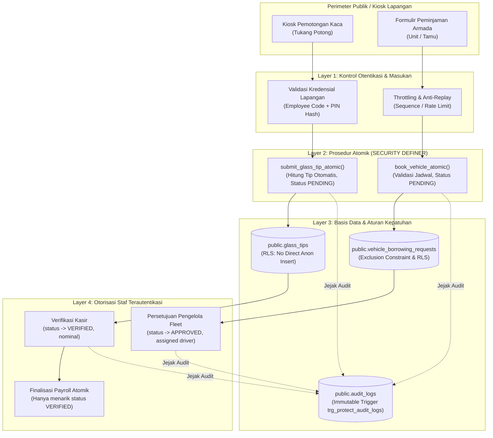

# PHASE 1 — PUBLIC TRANSACTION SECURITY DESIGN
## KUK Management System v3.1.0

**Tanggal Penyusunan:** 2026-11-05 13:46:00 +07:00  
**Baseline Repositori:** Commit `b77fc9096c36f6a339480d638f1900888d8c2b75` (`b77fc90`)  
**Status Fase 1:** **`OPEN`** (Desain Arsitektur & Analisis Ancaman)  
**Target Keamanan:** Formulir Publik, Terminal Kiosk, dan Transaksi Tanpa Sesi JWT Terautentikasi  

---

## 1. RINGKASAN EKSEKUTIF & PRINSIP ARSITEKTUR

KUK Management System v3.1.0 melayani kebutuhan operasional multi-unit (retail, pabrik pemotongan kaca, dan logistik) di mana sebagian staf lapangan (tukang potong kaca, pemohon armada publik) tidak memiliki akun login Supabase Auth (`auth.users`).

Untuk memfasilitasi kebutuhan ini tanpa mengorbankan integritas data keuangan dan kepatuhan hukum, diterapkan prinsip arsitektur pertahanan berlapis (*Defense-in-Depth*):



---

## 2. THREAT MODELING TRANSAKSI PUBLIK (STRIDE)

| Ancaman (Threat) | Kategori STRIDE | Komponen Terdampak | Skenario Eksploitasi Aktual di Baseline | Tingkat Keparahan |
| :--- | :--- | :--- | :--- | :---: |
| **Injeksi Nominal Gaji Fiktif** | Elevation of Privilege / Tampering | `glass_tips` | Klien anonim mengirim `POST /rest/v1/glass_tips` dengan `status = 'VERIFIED'` dan `verified_amount = 5.000.000`. Payroll otomatis menyerap tip ke slip gaji karyawan. | **CRITICAL** |
| **Penguncian Armada Fiktif (Denial of Service)** | Denial of Service | `vehicle_borrowing_requests` | Klien anonim mengirim request dengan `status = 'APPROVED'`. Partial exclusion constraint mengunci jadwal armada dari peminjam yang sah. | **HIGH** |
| **Pemalsuan Identitas Aktor Audit** | Repudiation / Spoofing | `audit_logs` | Klien terautentikasi mengirim `actor_id` milik Super Admin pada `POST /rest/v1/audit_logs` untuk memfitnah atau membuat alibi palsu. | **HIGH** |
| **Spam / Storage Bloat** | Denial of Service | `public_form_tokens` | Klien anonim memanfaatkan `GRANT INSERT` dan policy `WITH CHECK (true)` untuk membanjiri tabel dormant dengan jutaan baris token palsu. | **MEDIUM** |
| **Klaim Tip oleh Karyawan Palsu** | Spoofing | `glass_tips` | Seseorang memasukkan `employee_id` rekan kerjanya agar insentif potongan kaca masuk ke rekannya tanpa pemotongan nyata. | **MEDIUM** |

---

## 3. DESAIN KEAMANAN: GLASS TIPS (KIOSK PEMOTONGAN KACA)

### 3.1. Validasi Identitas Karyawan & PIN Kiosk
- **Masalah Baseline:** Klien anonim hanya mengirimkan `employee_id`. Foreign key hanya membuktikan karyawan terdaftar di unit tersebut, bukan bahwa orang di depan terminal adalah karyawan bersangkutan.
- **Solusi Desain:**
  - Mengadopsi mekanisme yang telah terpasang pada `submit_leave_request_atomic`: Memanfaatkan tabel `public.employee_portal_auth`.
  - Pekerja memasukkan **Employee Code** + **6-digit PIN**.
  - Pengecekan dilakukan secara atomik di dalam fungsi stored procedure dengan fungsi enkripsi `crypt(p_pin, pin_hash)`.
  - Proteksi Brute-Force: Jika salah 5 kali berturut-turut, akun portal terkunci selama 30 menit (`locked_until = now() + INTERVAL '30 minutes'`).

### 3.2. Validasi Unit, Nominal & Pencegahan Manipulasi `VERIFIED`
- **Prinsip Utama:** Klien (browser/kiosk) **DILARANG MENGHITUNG NOMINAL TIP**.
- Klien hanya mengirimkan dimensi fisik:
  - `unit_id`
  - `employee_id`
  - `glass_type_id`
  - `length_cm`
  - `height_cm`
  - `quantity`
- **Kalkulasi Server-Side:**
  - Stored procedure mengambil snapshot harga kaca dan persentase tip aktif dari tabel `glass_types` dan `glass_tip_rates`.
  - $\text{calculated\_sqm} = \frac{\text{length\_cm} \times \text{height\_cm}}{10.000} \times \text{quantity}$
  - $\text{tip\_amount} = \text{calculated\_sqm} \times \text{glass\_price\_snapshot} \times \text{tip\_percentage\_snapshot}$
  - Status **DIKUNCI MUTLAK** pada nilai `'PENDING'`.
  - Kolom `verified_amount` dan `payroll_period_id` diatur bernilai `NULL`.

### 3.3. Pencegahan Duplikasi & Replay Submission
- Kolom `reference_code` di-generate secara atomik di backend menggunakan format terpusat:  
  `TIP-[KODE_UNIT]-[YYYYMMDD]-[SEKUENSI_6_DIGIT]` via fungsi `generate_document_number_atomic`.
- Klien tidak dapat menentukan sendiri `reference_code`.

### 3.4. Validasi Sebelum Masuk Payroll
- Fungsi finalisasi gaji `calculate_and_finalize_payroll_atomic` hanya menarik tip dengan filter:
  `WHERE unit_id = p_unit_id AND employee_id = v_emp.id AND status = 'VERIFIED' AND payroll_period_id IS NULL`.
- Tip `PENDING` atau yang ditolak (`REJECTED`) dijamin tidak akan terserap ke slip gaji.
- Penandaan `payroll_period_id = p_payroll_period_id` saat finalisasi menjamin tip tidak dapat diklaim lebih dari satu kali (*anti-double claiming*).

---

## 4. DESAIN KEAMANAN: VEHICLE BORROWING (PEMINJAMAN ARMADA)

### 4.1. Validasi Unit, Kendaraan, dan Status Awal
- Validasi keberadaan armada pada unit bersangkutan (`vehicles.is_active = TRUE AND vehicles.status != 'DECOMMISSIONED'`).
- Validasi kronologis: `estimated_return_time > start_time`.
- **Status Awal Mutlak:** Seluruh pengajuan baru melalui jalur publik **WAJIB** berstatus `'PENDING'`.
- Kolom `approved_by`, `approved_at`, dan `cancellation_reason` wajib bernilai `NULL`.

### 4.2. Penutupan Celah Double Booking & Penolakan Bypass
- **Eliminasi Direct INSERT Anonim:**
  - Mencabut policy direct insert terbuka: `DROP POLICY "vehicle_borrowing_requests_insert_anon"`.
  - Mewajibkan seluruh pengajuan publik melewati fungsi atomik `book_vehicle_atomic`.
- **Exclusion Constraint Guard:**
  Exclusion constraint `excl_active_vehicle_booking` hanya aktif untuk `status IN ('APPROVED', 'IN_USE')`. Karena pengajuan publik selalu `PENDING`, permohonan baru tidak akan memicu *denial-of-service* terhadap jadwal kendaraan lain sebelum disetujui petugas.

### 4.3. Otorisasi Approval Bertingkat
- Persetujuan permohonan pinjam hanya dapat dilakukan oleh staf terautentikasi yang memegang izin `fleet.approve_borrowing`.
- Pada saat approval:
  - Staf memeriksa ketersediaan fisik armada.
  - Memverifikasi SIM pengemudi dan penanggung jawab.
  - Mengubah status menjadi `'APPROVED'` dengan merekam `approved_by = auth.uid()` dan `approved_at = now()`.

---

## 5. DESAIN INTEGRITAS AUDIT TRAIL (`audit_logs`)

### 5.1. Asal Identitas Aktor (`actor_id`)
Pada arsitektur Supabase PostgREST, identitas aktor ditentukan dari lapisan JWT:
- PostgREST mengekstrak JWT dan mengisi sesi runtime PostgreSQL:
  - `request.jwt.claim.sub` $\rightarrow$ UUID akun pengguna `auth.users`.
  - `request.jwt.claim.role` $\rightarrow$ Role database (`authenticated` atau `anon`).
- Fungsi SQL `auth.uid()` mengambil nilai dari konfigurasi tersebut.

### 5.2. Penegakan Kepercayaan Identitas Aktor
- **Masalah:** Pada policy baseline `audit_logs_insert WITH CHECK (true)`, nilai `actor_id` dapat dikirim bebas oleh klien di dalam payload JSON (bisa memasukkan ID akun orang lain).
- **Kontrol Wajib:**
  Mengganti policy insert dengan validasi identitas terikat:
  ```sql
  CREATE POLICY "audit_logs_insert" ON public.audit_logs
      FOR INSERT TO authenticated
      WITH CHECK (actor_id = auth.uid());
  ```
- Alternatif DDL: Mengatur `actor_id UUID NOT NULL DEFAULT auth.uid()`.

### 5.3. Pemisahan Request `authenticated` vs `service_role`
- Ketika request berasal dari token `service_role`, nilai `auth.role()` adalah `'service_role'` dan `auth.uid()` adalah `NULL`.
- Policy `audit_logs_insert` hanya diberikan kepada `authenticated`. Role `anon` dan publik tidak memiliki hak INSERT pada tabel ini.
- Hak `service_role` dipertahankan untuk pencatatan otomatis oleh Edge Function atau proses batch backend.

### 5.4. Jaminan Immutabilitas Jejak Audit
Integritas log audit dijamin secara mutlak oleh trigger engine PostgreSQL:
```sql
CREATE TRIGGER trg_protect_audit_logs
BEFORE UPDATE OR DELETE ON audit_logs
FOR EACH ROW EXECUTE FUNCTION protect_audit_log_immutability();
```
Trigger ini melempar pengecualian `RAISE EXCEPTION 'Audit log bersifat immutable...' (SQLSTATE 'P0001')`. Tidak ada pengguna (bahkan pemilik unit atau Super Admin aplikasi) yang dapat mengedit atau menghapus riwayat log audit.

---

## 6. EVALUASI DAN STATUS `public_form_tokens`

### 6.1. Status Operasional Saat Ini
- **Fakta:** Tabel `public_form_tokens` dan fungsi `validate_and_consume_token` saat ini berstatus **DORMANT**.
- Tidak ada form atau alur di antarmuka web (Batch 1, 2, maupun 3) yang mewajibkan input token ini.
- Hak `GRANT INSERT ON TABLE public_form_tokens TO anon` pada skema awal adalah cacat keamanan struktural karena memungkinkan publik membanjiri tabel tanpa tujuan fungsional.

### 6.2. Keputusan Arsitektur:
1. **Jangka Pendek (Remediasi Segera):**
   - Hapus policy `public_form_tokens_anon_insert`.
   - Jalankan `REVOKE ALL ON TABLE public.public_form_tokens FROM anon;`.
   - Mengunci tabel secara mutlak agar tidak menjadi target *storage exhaustion attack*.
2. **Jangka Panjang (Jika Fitur Token Diaktifkan):**
   - Token hanya boleh di-generate oleh staf terautentikasi (misal HRD mengirim link form cuti dengan token sekali pakai kepada staf di luar toko).
   - Validasi dan konsumsi token **WAJIB ATOMIK** di dalam transaksi stored procedure:
     ```sql
     UPDATE public_form_tokens
     SET use_count = use_count + 1, consumed_at = now()
     WHERE token_hash = p_token_hash AND use_count < max_uses AND expires_at > now()
     RETURNING id;
     ```

---

## 7. REKOMENDASI ARSITEKTUR: ATOMIC RPC VS EDGE FUNCTION VS BACKEND

| Kriteria Evaluasi | Opsi A: Direct Anon Insert + RLS | Opsi B: Atomic RPC (`SECURITY DEFINER`) | Opsi C: Supabase Edge Functions | Opsi D: Backend Server Terpisah (Express/Nest) |
| :--- | :--- | :--- | :--- | :--- |
| **Keamanan Status & Nominal** | Rendah (Klien kirim nominal) | **Sangat Tinggi (Kalkulasi Server)** | **Sangat Tinggi** | **Sangat Tinggi** |
| **Validasi PIN / Identitas** | Sulit di-handle di RLS | **Native via `employee_portal_auth`**| Didukung via DB Call | Didukung |
| **Kompleksitas Infrastruktur** | Sangat Rendah | **Sangat Rendah (Nol Server Baru)** | Sedang (Perlu Deno & Deploy) | Tinggi (Perlu VM/Container) |
| **Performa & Latensi** | Cepat | **Sangat Cepat (In-Database)** | Sedang (Cold Start 300-800ms)| Cepat |
| **Kesesuaian dengan KUK V3** | Rentan Celah Keamanan | **SANGAT IDEAL (Kanonikal)** | Berlebihan untuk skala saat ini| Memecah arsitektur Jamstack |

### Rekomendasi Resmi:
> [!IMPORTANT]
> **REKOMENDASI: Opsi B — Stored Procedure Atomik (`SECURITY DEFINER`) dengan Validasi PIN**.  
> KUK Management System v3.1.0 telah memiliki preseden sukses dengan `submit_leave_request_atomic` dan `book_vehicle_atomic`.
> Pendekatan ini:
> 1. Menutup total hak direct INSERT tabel dari role `anon`.
> 2. Memusatkan seluruh logika bisnis (kalkulasi m², penentuan tarif, status PENDING, penomoran seri, dan hashing PIN) ke dalam 1 transaksi atomik database.
> 3. Tidak memerlukan biaya hosting tambahan atau pemeliharaan server backend baru.

---

## 8. RANCANGAN PERUBAHAN SKEMA DDL / RPC YANG DIPERLUKAN

Untuk mengimplementasikan arsitektur ini secara penuh pada fase mendatang, rancangan DDL disiapkan sebagai berikut:

### 8.1. Spesifikasi Prosedur Baru: `submit_glass_tip_atomic`
```sql
CREATE OR REPLACE FUNCTION public.submit_glass_tip_atomic(
    p_unit_id UUID,
    p_employee_code VARCHAR(50),
    p_auth_pin VARCHAR(10),
    p_glass_type_id UUID,
    p_length_cm NUMERIC(10, 2),
    p_height_cm NUMERIC(10, 2),
    p_quantity INT,
    p_notes TEXT DEFAULT NULL
)
RETURNS JSONB
LANGUAGE plpgsql
SECURITY DEFINER
SET search_path = public, pg_temp
AS $$
DECLARE
    v_emp RECORD;
    v_auth RECORD;
    v_type RECORD;
    v_sqm NUMERIC(10, 4);
    v_tip_amount NUMERIC(12, 2);
    v_code VARCHAR(50);
    v_tip_id UUID;
    v_period_key VARCHAR(10);
BEGIN
    -- 1. Validasi Karyawan & PIN Kiosk
    SELECT e.id, e.unit_id INTO v_emp 
    FROM employees e 
    WHERE e.unit_id = p_unit_id AND e.employee_code = p_employee_code AND e.status = 'ACTIVE';
    IF NOT FOUND THEN
        RAISE EXCEPTION 'Karyawan tidak ditemukan atau status tidak aktif.';
    END IF;

    SELECT * INTO v_auth FROM employee_portal_auth WHERE employee_id = v_emp.id;
    IF NOT FOUND OR v_auth.pin_hash != crypt(p_auth_pin, v_auth.pin_hash) THEN
        RAISE EXCEPTION 'PIN otentikasi kiosk salah.';
    END IF;

    -- 2. Ambil Master Tarif & Tipe Kaca
    SELECT * INTO v_type FROM glass_types WHERE id = p_glass_type_id AND unit_id = p_unit_id;
    IF NOT FOUND THEN
        RAISE EXCEPTION 'Tipe kaca tidak valid untuk unit ini.';
    END IF;

    -- 3. Hitung Luas & Nominal Tip Server-Side (Contoh snapshot 3% atau flat rate unit)
    v_sqm := (p_length_cm * p_height_cm / 10000.0) * p_quantity;
    v_tip_amount := ROUND(v_sqm * 150000.0 * 0.03, 2); -- Sesuai formula rate master

    -- 4. Generate Nomor Nota Berurut
    v_period_key := to_char((now() AT TIME ZONE 'Asia/Jakarta')::date, 'YYYYMM');
    v_code := generate_document_number_atomic(p_unit_id, 'TIP', v_period_key);

    -- 5. Insert dengan Status Terkunci PENDING
    INSERT INTO glass_tips (
        unit_id, reference_code, employee_id, glass_type_id, length_cm, height_cm,
        quantity, calculated_sqm, glass_price_snapshot, tip_percentage_snapshot,
        tip_amount, verified_amount, status, notes
    ) VALUES (
        p_unit_id, v_code, v_emp.id, p_glass_type_id, p_length_cm, p_height_cm,
        p_quantity, v_sqm, 150000.0, 0.0300, v_tip_amount, NULL, 'PENDING', p_notes
    ) RETURNING id INTO v_tip_id;

    RETURN jsonb_build_object(
        'success', TRUE,
        'tip_id', v_tip_id,
        'reference_code', v_code,
        'calculated_sqm', v_sqm,
        'estimated_tip', v_tip_amount,
        'status', 'PENDING'
    );
END;
$$;
```

---

## 9. MATRIKS TEST CASES (POSITIF & NEGATIF)

| ID Uji | Modul | Kategori | Skenario Pengujian | Input Payload / Parameter | Ekspektasi Hasil |
| :--- | :--- | :--- | :--- | :--- | :--- |
| **TC-GT-01** | Glass Tips | Positif | Pengajuan tip valid via Kiosk | Employee code valid, PIN valid, dimensi normal | Status 200, row `glass_tips` dibuat dengan `status = 'PENDING'`, `verified_amount = null` |
| **TC-GT-02** | Glass Tips | Negatif | Injeksi tip langsung via PostgREST | `POST /rest/v1/glass_tips` dengan `status = 'VERIFIED'` | Ditutupi RLS: `42501 (violates RLS policy)` |
| **TC-GT-03** | Glass Tips | Negatif | PIN salah 5x pada Kiosk | PIN acak 5 kali berturut-turut | Akun terkunci, pesan `Akun portal terkunci sementara 30 menit` |
| **TC-GT-04** | Glass Tips | Negatif | Injeksi nominal kustom dari form | Payload form mencoba memanipulasi `tip_amount: 99999999` | Nilai diabaikan, DB menghitung m² $\times$ tarif resmi |
| **TC-VB-01** | Fleet | Positif | Pengajuan armada valid via RPC | Kendaraan aktif, `start_time` di masa depan, durasi valid | Status 200, row `vehicle_borrowing_requests` dibuat berstatus `'PENDING'` |
| **TC-VB-02** | Fleet | Negatif | Injeksi status APPROVED via REST | `POST /rest/v1/vehicle_borrowing_requests` dengan `status: 'APPROVED'` | Ditutupi RLS: `42501 (violates RLS policy)` |
| **TC-VB-03** | Fleet | Negatif | Double booking pada rentang waktu sama | Waktu pinjam bertabrakan dengan request lain yang sudah `APPROVED` | Ditolak oleh exclusion constraint `excl_active_vehicle_booking` |
| **TC-AL-01** | Audit | Positif | Insert audit log terautentikasi sah | `actor_id` sama persis dengan `auth.uid()` JWT | 201 Created |
| **TC-AL-02** | Audit | Negatif | Pemalsuan `actor_id` (Spoofing) | `actor_id = <Super Admin UUID>`, JWT milik Kasir | Ditutupi RLS: `42501 (new row violates RLS policy)` |
| **TC-AL-03** | Audit | Negatif | Upaya modifikasi/hapus jejak audit | `DELETE FROM audit_logs WHERE id = ...` | Ditolak trigger `P0001 (Audit log bersifat immutable)` |
| **TC-TK-01** | Token | Negatif | Injeksi token oleh klien publik | `POST /rest/v1/public_form_tokens` dari role `anon` | Ditolak SQL Privilege: `42501 (Permission Denied for table)` |

---

## 10. KLASIFIKASI KONTROL KEAMANAN

Untuk panduan implementasi terukur, kontrol diklasifikasikan ke dalam 3 status:

### A. Kontrol yang SUDAH TERSEDIA (Proven Baseline)
1. **Trigger Immutabilitas Audit Log:** `trg_protect_audit_logs` melindungi integritas log audit dari UPDATE dan DELETE (`P0001`).
2. **Exclusion Constraint Armada:** `excl_active_vehicle_booking` mencegah tabrakan jadwal peminjaman pada armada aktif.
3. **Penyerap Gaji Terisolasi:** `calculate_and_finalize_payroll_atomic` hanya menarik tip berstatus `'VERIFIED'` dan `payroll_period_id IS NULL`.
4. **Relasi Foreign Key Komposit:** Seluruh entitas memvalidasi pasangan `(unit_id, id)` untuk mencegah percampuran data antar unit.

### B. Kontrol yang HARUS DIBANGUN (Remediasi Tahap Berikutnya)
1. **Pengetatan RLS Kebijakan Insert Anonim:** Menerapkan draft `20261105000001_remediate_rls_security.sql` untuk mengunci `glass_tips` dan `vehicle_borrowing_requests` ke status `PENDING` dengan nilai persetujuan `NULL`.
2. **Pencabutan Hak Insert Token:** Menjalankan `REVOKE INSERT ON public_form_tokens FROM anon`.
3. **Penegakan `actor_id = auth.uid()`:** Pada kebijakan `audit_logs_insert`.
4. **Pembuatan RPC `submit_glass_tip_atomic`:** Menggantikan direct insert dengan prosedur ber-PIN untuk terminal pemotongan kaca.

### C. Kontrol yang MEMERLUKAN PENGUJIAN DATABASE NYATA
1. **Validasi PostgREST Header Handling:** Menguji apakah translasi error RLS `42501` diterima dengan benar oleh antarmuka frontend tanpa membocorkan struktur tabel.
2. **Pengujian Efektivitas Restrictive Delete:** Membuktikan bahwa kebijakan `AS RESTRICTIVE FOR DELETE TO authenticated USING (false)` benar-benar memblokir perintah hard-delete manajer unit pada PostgreSQL 17.
3. **Uji Konkurensi Kiosk:** Menguji respons stored procedure saat puluhan terminal kiosk mengirimkan data potongan kaca secara bersamaan pada pergantian shift.

