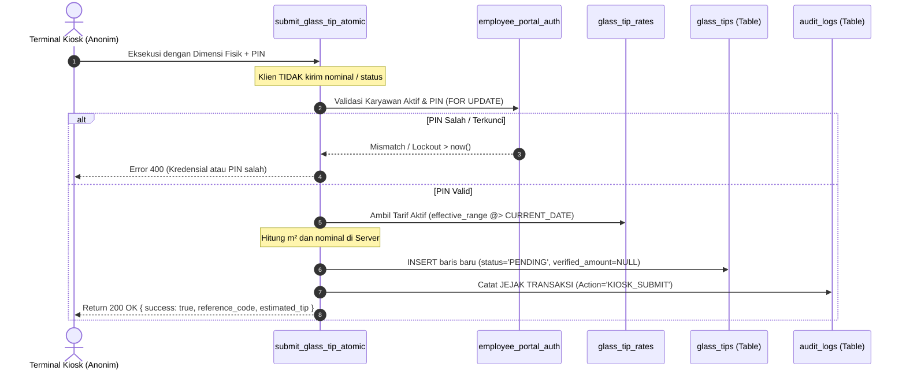
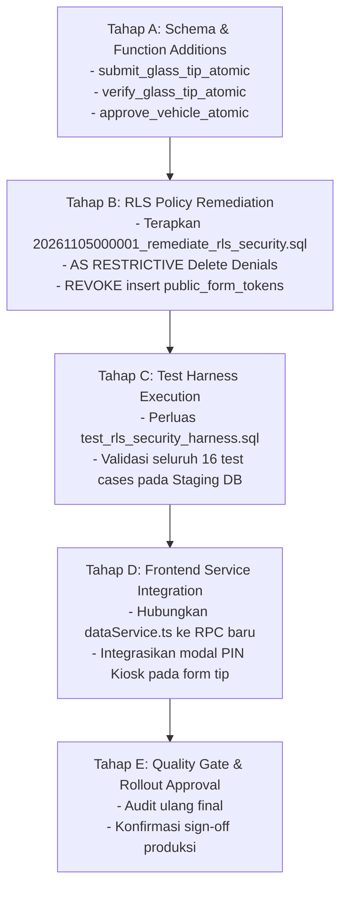

# PHASE 1 — SECURITY IMPLEMENTATION SPECIFICATION
## KUK Management System v3.1.0

**Dokumen Versi:** 3.1.0-SPEC  
**Tanggal:** 2026-11-05 13:50:00 +07:00  
**Baseline Repositori:** Commit `b77fc9096c36f6a339480d638f1900888d8c2b75` (`b77fc90`)  
**Status Fase 1:** **`OPEN`** (Spesifikasi Teknis & Panduan Implementasi)  
**Target Basis Data:** PostgreSQL 17 (Supabase Architecture) — **ANALYSIS & DOCUMENTATION ONLY**  

---

## 1. EXISTING ARCHITECTURE REVIEW & COMPONENT REUSABILITY

Audit menyeluruh terhadap skema kanonikal `supabase/migrations/20261104000001_core_schema_v3_1_0.sql` dan `20261104000002_harden_rpc_security.sql` mengidentifikasi komponen yang sudah ada dan dapat digunakan kembali (*reusable*):

```text
+---------------------------------------------------------------------------------------------------------------------+
| Objek Eksisting               | Jenis Objek        | Status & Fungsionalitas              | Pemanfaatan Ulang       |
+---------------------------------------------------------------------------------------------------------------------+
| public.employee_portal_auth   | Table              | Menyimpan hash PIN bcrypt, failed_   | Inti otentikasi kiosk   |
|                               |                    | attempts, dan lockout timestamp.     | pemotongan kaca & cuti  |
|                               |                    |                                      |                         |
| submit_leave_request_atomic   | Function (Definer) | Template verifikasi PIN, rate limit, | Model arsitektur untuk  |
|                               |                    | sequence numbering & audit log.      | submit_glass_tip_atomic |
|                               |                    |                                      |                         |
| book_vehicle_atomic           | Function (Definer) | Mengatur jadwal peminjaman, nomor    | Dipertahankan & ditutup |
|                               |                    | booking FLEET, dan status PENDING.   | celah direct INSERT-nya |
|                               |                    |                                      |                         |
| generate_document_number_     | Function (Definer) | Generator nomor seri berurut atomik  | Digunakan untuk nota TIP|
| atomic                        |                    | per unit dan per bulan (FOR UPDATE). | dan booking FLEET       |
|                               |                    |                                      |                         |
| calculate_and_finalize_       | Function (Definer) | Menghitung gaji, menyerap tip        | Tetap menjadi muara     |
| payroll_atomic                |                    | VERIFIED, dan menandai periode tip.  | transaksi tip kaca      |
|                               |                    |                                      |                         |
| public.glass_tip_rates &      | Tables & Exclusion | Master tarif per m2, effective range | Sumber tarif server-side|
| glass_tip_rate_ranges         | Constraint GIST    | DATERANGE, dan rentang luas kaca.    | (bukan hardcoded 3%)    |
|                               |                    |                                      |                         |
| trg_protect_audit_logs        | Trigger (P0001)    | Mencegah UPDATE dan DELETE pada      | Fondasi immutabilitas   |
|                               |                    | tabel audit_logs.                    | jejak audit sistem      |
+---------------------------------------------------------------------------------------------------------------------+
```

> [!IMPORTANT]
> **Prinsip Anti-Duplikasi:** Sistem **TIDAK AKAN** membuat tabel otentikasi baru. Tabel `employee_portal_auth` dan fungsi penomoran `generate_document_number_atomic` diperluas penggunaannya untuk seluruh transaksi kiosk mandiri.

---

## 2. SPESIFIKASI EMPLOYEE PIN AUTHENTICATION

Untuk terminal mandiri (Kiosk Pemotongan Kaca dan Kiosk Cuti) di mana karyawan tidak memiliki akun Supabase Auth, otentikasi ditegakkan melalui kombinasi **Employee Code** + **6-digit Numeric PIN**.

### 2.1. Standar Kriptografi PIN Berentropi Rendah
PIN 6-digit hanya memiliki $10^6$ kemungkinan kombinasi (entropi $\approx 19.93$ bit). Penggunaan hash cepat (seperti SHA-256 atau MD5) **DILARANG KERAS** karena rentan di-brute force via GPU dalam hitungan milidetik.
- **Algoritma:** **Bcrypt** melalui fungsi native PostgreSQL `pgcrypto`:
  $$\text{pin\_hash} = \text{crypt}(p\_auth\_pin, \text{gen\_salt}('bf', 10))$$
- **Cost Factor:** 10 (memerlukan $\approx 100\text{ms}$ CPU time per verifikasi di PostgreSQL engine).
- **Salt:** Salt acak 128-bit dihasilkan secara otomatis dan tersimpan terpadu di dalam string hash `$2a$10$...`.

### 2.2. Penanganan Percobaan Paralel & Lockout Mutlak
Untuk mencegah *race condition* di mana penyerang mengirim puluhan request paralel sebelum nilai `failed_attempts` dinaikkan:
```sql
-- Kunci baris otentikasi secara eksklusif dalam transaksi
SELECT * INTO v_auth
FROM employee_portal_auth
WHERE employee_id = v_emp.id
FOR UPDATE;

-- 1. Evaluasi Status Lockout
IF v_auth.locked_until IS NOT NULL AND v_auth.locked_until > now() THEN
    RAISE EXCEPTION 'Akun portal karyawan terkunci sementara hingga % karena 5x kegagalan autentikasi.',
        to_char(v_auth.locked_until AT TIME ZONE 'Asia/Jakarta', 'HH24:MI:SS WIB');
END IF;

-- 2. Evaluasi Hash PIN
IF v_auth.pin_hash != crypt(p_auth_pin, v_auth.pin_hash) THEN
    UPDATE employee_portal_auth
    SET failed_attempts = failed_attempts + 1,
        locked_until = CASE WHEN failed_attempts + 1 >= 5 THEN now() + INTERVAL '30 minutes' ELSE NULL END,
        updated_at = now()
    WHERE employee_id = v_emp.id;

    -- Catat ke activity_logs
    INSERT INTO activity_logs (unit_id, action, details)
    VALUES (p_unit_id, 'AUTH_PIN_FAILED', jsonb_build_object('employee_id', v_emp.id, 'attempt', v_auth.failed_attempts + 1));

    RAISE EXCEPTION 'Otentikasi Kiosk Gagal: Kredensial atau PIN salah.';
ELSE
    -- Reset kegagalan saat berhasil
    UPDATE employee_portal_auth
    SET failed_attempts = 0,
        locked_until = NULL,
        last_login_at = now(),
        updated_at = now()
    WHERE employee_id = v_emp.id;
END IF;
```

### 2.3. Pencegahan Enumerasi Employee Code
Jika employee code tidak terdaftar, database **TIDAK BOLEH** melempar pesan *“Karyawan tidak ditemukan”*. Pesan kegagalan harus diseragamkan:
`'Otentikasi Kiosk Gagal: Kredensial atau PIN salah.'`
Hal ini mencegah pihak luar memindai NIK/kode karyawan yang aktif.

### 2.4. Pemulihan & Penggantian PIN
- Reset PIN hanya dapat dijalankan oleh staf HRD/Manager Unit yang memegang izin `employees.manage_sensitive`.
- Disediakan prosedur khusus `reset_employee_kiosk_pin(p_unit_id, p_employee_id, p_new_pin)` yang memvalidasi otorisasi petugas dan mencatat aksi reset ke `audit_logs`.

---

## 3. SPESIFIKASI TRANSAKSI: GLASS TIPS (`submit_glass_tip_atomic`)

### 3.1. Kontrak Antarmuka Prosedur
```sql
CREATE OR REPLACE FUNCTION public.submit_glass_tip_atomic(
    p_unit_id UUID,
    p_employee_code VARCHAR(50),
    p_auth_pin VARCHAR(10),
    p_glass_type_id UUID,
    p_length_cm NUMERIC(10, 2),
    p_height_cm NUMERIC(10, 2),
    p_quantity INT,
    p_client_notes TEXT DEFAULT NULL
)
RETURNS JSONB
LANGUAGE plpgsql
SECURITY DEFINER
SET search_path = public, pg_temp;
```

### 3.2. Urutan Logika Validasi & Kalkulasi Server-Side


### 3.3. Penanganan Dinamika Tarif & Riwayat Perubahan
- **Sumber Tarif:** Tabel `glass_tip_rates` memiliki kolom `effective_range DATERANGE` dan exclusion constraint `excl_tip_rate_no_overlap`.
- **Snapshot Transaksional:** Saat tip di-insert, sistem menyalin snapshot:
  - `glass_price_snapshot = glass_types.base_price` (atau base price tipe kaca).
  - `tip_percentage_snapshot = glass_tip_rates.base_rate` (atau formula persentase).
  - `tip_amount = ROUND(luas_m2 * tarif_aktif, 2)`.
- **Dampak Perubahan Tarif:** Perubahan tarif di master data pada tanggal $T$ **TIDAK AKAN** mengubah nilai estimasi pada transaksi yang dibuat sebelum tanggal $T$. Transaksi lama tetap mengacu pada nilai snapshot.

---

## 4. SPESIFIKASI TRANSAKSI: VEHICLE BORROWING (`book_vehicle_atomic`)

### 4.1. Kontrak Antarmuka Prosedur
```sql
CREATE OR REPLACE FUNCTION public.book_vehicle_atomic(
    p_unit_id UUID,
    p_vehicle_id UUID,
    p_borrower_name VARCHAR(150),
    p_borrower_institution VARCHAR(150),
    p_borrower_phone VARCHAR(30),
    p_responsible_person VARCHAR(150),
    p_start_time TIMESTAMPTZ,
    p_estimated_return_time TIMESTAMPTZ,
    p_destination TEXT,
    p_purpose TEXT
)
RETURNS JSONB
LANGUAGE plpgsql
SECURITY DEFINER
SET search_path = public, pg_temp;
```

### 4.2. Aturan Keamanan & Konkurensi
1. **Kunci Armada Eksklusif:** Mengambil data armada dengan row lock `SELECT id, status FROM vehicles WHERE unit_id = p_unit_id AND id = p_vehicle_id FOR SHARE;`.
2. **Validasi Waktu Ketat:**
   - `p_start_time >= (now() - INTERVAL '15 minutes')` (mencegah booking mundur ke masa lalu).
   - `p_estimated_return_time > p_start_time` (durasi minimal 15 menit).
3. **Status PENDING Terkunci:** Baris baru di-insert dengan:
   - `status = 'PENDING'`
   - `approved_by = NULL`
   - `approved_at = NULL`
   - `cancellation_reason = NULL`
4. **Pencegahan Double Booking:**
   Meskipun status awal adalah `PENDING`, sistem memeriksa apakah sudah ada reservasi berstatus `APPROVED` atau `IN_USE` pada rentang waktu yang sama:
   ```sql
   IF EXISTS (
       SELECT 1 FROM vehicle_borrowing_requests
       WHERE vehicle_id = p_vehicle_id
         AND status IN ('APPROVED', 'IN_USE')
         AND tstzrange(start_time, estimated_return_time, '[)') && tstzrange(p_start_time, p_estimated_return_time, '[)')
   ) THEN
       RAISE EXCEPTION 'Kendaraan telah disetujui untuk peminjaman lain pada jadwal tersebut.';
   END IF;
   ```

---

## 5. SPESIFIKASI PROSEDUR VERIFIKASI & APPROVAL STAF

### 5.1. Prosedur Verifikasi Tip Kaca (`verify_glass_tip_atomic`)
- **Pelaksana:** Petugas Kasir / Pengelola Unit terautentikasi (`authenticated`).
- **Izin Wajib:** `glass_tips.verify` pada `p_unit_id`.
- **Logika Status Transition:**
  - Hanya dapat memproses baris berstatus `'PENDING'`.
  - Jika aksi = `'VERIFY'`: status berubah menjadi `'VERIFIED'`, mengisi `verified_amount` (wajib $> 0$), mencatat `verified_by = auth.uid()` dan `verified_at = now()`.
  - Jika aksi = `'REJECT'`: status berubah menjadi `'REJECTED'`, `verified_amount = NULL`, mencatat alasan penolakan.
  - **Larangan Mutlak:** Tidak dapat mengubah baris yang sudah ditandai `payroll_period_id IS NOT NULL` (sudah diserap penggajian).

### 5.2. Prosedur Persetujuan Armada (`approve_vehicle_atomic`)
- **Pelaksana:** Pengelola Armada / Staf Operasional terautentikasi (`authenticated`).
- **Izin Wajib:** `fleet.approve_borrowing` pada `p_unit_id`.
- **Logika Status Transition:**
  - Hanya dapat memproses reservasi berstatus `'PENDING'`.
  - Mengunci baris sasaran via `FOR UPDATE`.
  - Saat status diubah menjadi `'APPROVED'`:
    - Mengisi `approved_by = auth.uid()` dan `approved_at = now()`.
    - Engine PostgreSQL secara otomatis mengevaluasi exclusion constraint `excl_active_vehicle_booking`. Jika terjadi benturan waktu dengan pemesanan lain yang disetujui berbarengan, transaksi di-rollback atomik oleh engine database.

---

## 6. RLS & RPC SECURITY MATRIX

| Prosedur / Fungsi | Mode Keamanan | Hak Eksekusi (`GRANT`) | Pemeriksaan Otorisasi Internal | Interaksi RLS & Keamanan |
| :--- | :--- | :--- | :--- | :--- |
| **`submit_glass_tip_atomic`** | `SECURITY DEFINER` | `anon`, `authenticated`, `service_role` | PIN Bcrypt via `employee_portal_auth` (Karyawan Aktif) | Mem-bypass RLS tabel `employee_portal_auth` yang tertutup `deny_all`. Menulis data `PENDING`. |
| **`book_vehicle_atomic`** | `SECURITY DEFINER` | `anon`, `authenticated`, `service_role` | Validasi armada aktif & parameter waktu | Menulis data `PENDING`. Direct insert ke tabel ditutup di draft migrasi. |
| **`verify_glass_tip_atomic`**| `SECURITY DEFINER` | **Hanya `authenticated`** (REVOKE dari anon & PUBLIC) | `has_unit_permission(unit_id, 'glass_tips.verify')` & `auth.uid() IS NOT NULL` | Menolak modifikasi tip yang sudah diserap payroll (`payroll_period_id IS NOT NULL`). |
| **`approve_vehicle_atomic`** | `SECURITY DEFINER` | **Hanya `authenticated`** (REVOKE dari anon & PUBLIC) | `has_unit_permission(unit_id, 'fleet.approve_borrowing')` & `auth.uid() IS NOT NULL` | Mengisi `approved_by = auth.uid()`. Terikat exclusion constraint aktif. |
| **`calculate_and_finalize_payroll_atomic`** | `SECURITY DEFINER` | **Hanya `authenticated`** (REVOKE dari anon & PUBLIC) | `has_unit_permission(unit_id, 'payroll.manage')` & anti-spoofing `p_finalized_by = auth.uid()` | Menandai `glass_tips.payroll_period_id` agar tidak diserap ganda. |
| **`cancel_leave_request_atomic`** | `SECURITY DEFINER` | **Hanya `authenticated`** (REVOKE dari anon & PUBLIC) | `has_unit_permission(unit_id, 'leave.manage')` & anti-spoofing `p_cancelled_by = auth.uid()` | Mengubah status cuti ke CANCELLED dan membebaskan conflict slots. |

> [!WARNING]
> **Super Admin Guard:** Seluruh fungsi di atas memvalidasi izin melalui `has_unit_permission()` dan `has_system_role()`. Tidak ada fungsi yang mengecek hak superuser PostgreSQL (`usesuper`). Pengguna `super_admin` aplikasi tetap terikat aturan pemeriksaan hak akses dan jejak audit JWT.

---

## 7. MATRIKS TEST SPECIFICATION (POSITIF & NEGATIF)

| ID Test | Kategori Skenario | Deskripsi Pengujian | Input & Kondisi | Ekspektasi Hasil | Klasifikasi Uji |
| :--- | :--- | :--- | :--- | :--- | :--- |
| **TS-01** | PIN Auth | Autentikasi PIN benar pada Kiosk | Kode karyawan aktif, PIN sesuai hash | Success: true, token/transaksi diproses | PostgreSQL Integration |
| **TS-02** | PIN Auth | Autentikasi PIN salah | PIN salah 1x | Error 400: 'Kredensial atau PIN salah', failed_attempts bertambah | PostgreSQL Integration |
| **TS-03** | PIN Auth | Lockout akun setelah 5x gagal | PIN salah 5x berturut-turut | Error: Akun terkunci sementara 30 menit | PostgreSQL Integration |
| **TS-04** | PIN Auth | Transaksi saat akun terkunci | Request masuk pada menit ke-5 lockout | Ditolak sebelum verifikasi hash | PostgreSQL Integration |
| **TS-05** | PIN Auth | Karyawan berstatus RESIGNED | Kode karyawan mantan staf | Error 400: Kredensial tidak valid | PostgreSQL Integration |
| **TS-06** | Concurrency | Percobaan PIN paralel serentak | 10 request concurrent pada attempt ke-4 | Baris di-lock FOR UPDATE; tepat 1 berhasil/gagal, sisa terkunci | Concurrency / Load Test |
| **TS-07** | Glass Tips | Injeksi status VERIFIED via REST | `POST /rest/v1/glass_tips` status='VERIFIED' | Ditolak RLS: Error `42501` | Supabase PostgREST E2E |
| **TS-08** | Glass Tips | Injeksi verified_amount via REST | `POST /rest/v1/glass_tips` verified_amount=500000 | Ditolak RLS: Error `42501` | Supabase PostgREST E2E |
| **TS-09** | Glass Tips | Manipulasi unit_id lintas unit | Unit La Tansa, employee_id Palen | Ditolak Foreign Key `(unit_id, employee_id)` | PostgreSQL Integration |
| **TS-10** | Glass Tips | Verifikasi oleh kasir berwenang | Kasir La Tansa dengan izin `glass_tips.verify` | Status berubah VERIFIED, verified_amount tercatat | PostgreSQL Integration |
| **TS-11** | Glass Tips | Verifikasi oleh kasir unit lain | Kasir Palen mencoba verifikasi tip La Tansa | Ditolak: Hak akses ditolak untuk unit ini | PostgreSQL Integration |
| **TS-12** | Fleet | Injeksi status APPROVED via REST | `POST /rest/v1/vehicle_borrowing_requests` status='APPROVED' | Ditolak RLS: Error `42501` | Supabase PostgREST E2E |
| **TS-13** | Fleet | Double booking overlapping | 2 request booking disetujui pada jam tumpang tindih | Ditolak exclusion constraint GIST | PostgreSQL Integration |
| **TS-14** | Audit | Manipulasi actor_id spoofing | `POST /rest/v1/audit_logs` actor_id $\ne$ auth.uid() | Ditolak RLS: Error `42501` | Supabase PostgREST E2E |
| **TS-15** | Audit | Hard delete log audit | `DELETE FROM audit_logs WHERE id = ...` | Ditolak trigger immutability: Error `P0001` | Unit / Logic Test |
| **TS-16** | Payroll | Double claiming tip terverifikasi | Finalisasi payroll kedua pada periode berbeda | Tip berstatus `payroll_period_id IS NOT NULL` diabaikan | PostgreSQL Integration |

---

## 8. IMPLEMENTATION ROADMAP & RISIKOMITIGASI

Implementasi dibagi ke dalam 5 tahapan berurutan (*sequential dependencies*):



### Analisis Ketergantungan & Risiko:
1. **Risiko Pemecahan UI Phase 2 (Breaking Changes):**
   - *Mitigasi:* Pembuatan fungsi baru tidak mengubah struktur tabel eksisting. Kolom `glass_tips` dan `vehicle_borrowing_requests` tetap utuh. Frontend Phase 2 yang ada saat ini tetap kompatibel.
2. **Risiko Penolakan Akses Anonim:**
   - *Mitigasi:* Penutupan direct insert ke tabel baru dilakukan **SETELAH** fungsi atomik `submit_glass_tip_atomic` terpasang dan diberikan izin `GRANT EXECUTE TO anon`.

---

## 9. KEPUTUSAN FINAL KESIAPAN (READINESS VERDICT)

> ### **STATUS: READY WITH CONDITIONS**

### Justifikasi Keputusan:
1. **Kesiapan Desain & Spesifikasi:** **100% LENGKAP**. Seluruh celah transaksi publik (SEC-01 s/d SEC-07), mekanisme PIN, formula tarif dinamis, dan prosedur persetujuan telah memiliki rancangan DDL dan logika PL/pgSQL yang presisi dan kompatibel dengan skema kanonikal.
2. **Kondisi / Blocker yang Tersisa Sebelum Eksekusi:**
   - **[BLOCKER 1 - STAGING ENVIRONMENT]:** Akun Supabase Free saat ini telah menggunakan 2 slot proyek aktif penuh (`cuunipngguedqttuutaa` dan `ckzciuybedefbsdfsexh`). Staging terpisah wajib disediakan (via pause proyek lain atau akun ke-2) sebelum skrip SQL dapat diuji.
   - **[BLOCKER 2 - EXECUTIVE SIGN-OFF KEBIJAKAN TARIF]:** Kebijakan bisnis mengenai formula tip kaca (apakah menggunakan persentase harga snapshot, tarif tetap per m², atau skema minimum) harus dikonfirmasi oleh pemilik bisnis sebelum data master `glass_tip_rates` diisi secara definitif.
   - **[BLOCKER 3 - ZERO-MUTATION PROD RULE]:** Migrasi dan DDL dilarang keras dijalankan langsung ke Supabase Cloud Production (`ckzciuybedefbsdfsexh`).

