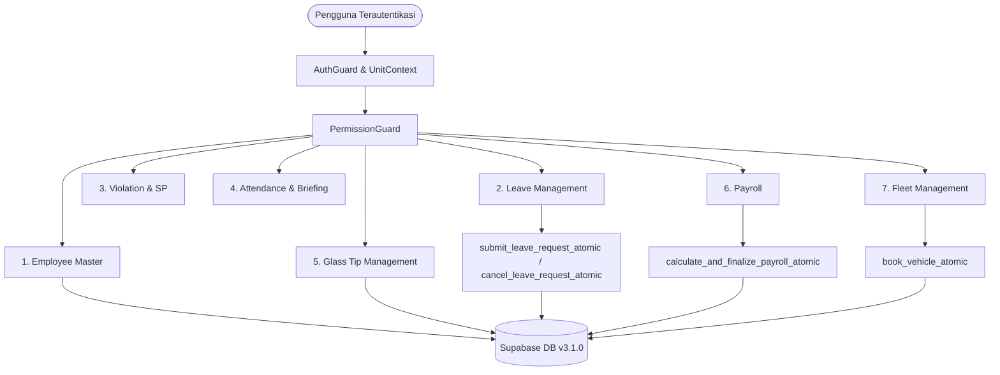

# PHASE 2 — MODULE ARCHITECTURE & BACKEND MAPPING SPECIFICATION
## KUK MANAGEMENT SYSTEM v3.1.0

> **STATUS: COMPLETE SYSTEM BLUEPRINT & DATA MAPPING**  
> **SCOPE: 7 Core Modules, 60 Database Tables, 18 ENUMs, 10 Atomic RPCs, Permission & Unit Context Binding**  
> **PRINSIP ARSITEKTUR: Menggunakan skema v3.1.0 yang sudah ada di database tanpa duplikasi tabel atau modifikasi skema non-standar.**

---

## 1. IKHTISAR ARSITEKTUR MODUL PHASE 2

Phase 2 mencakup implementasi antarmuka dan integrasi data untuk 7 modul utama KUK Management System. Seluruh modul dirancang terisolasi per unit (`unit_id` scoping) dan diautentikasi ketat melalui Permission Guard dan Auth Context.



---

## 2. SPESIFIKASI MAPPING 7 MODUL OPERASIONAL

---

### 2.1. Modul 1: Employee Master (Manajemen Data SDM & Profil)

- **Deskripsi Bisnis**: Mengelola siklus hidup data karyawan di setiap unit bisnis (TB KUK La Tansa, KUK Palen), mencakup departemen, jabatan, status kerja, riwayat mutasi jabatan, dan data sensitif (NIK, rekening gaji).
- **Tabel Basis Data**:
  - `employees` (Tabel utama: nama, NIP, status kerja, tanggal bergabung)
  - `departments` (Departemen/bagian unit)
  - `positions` (Jabatan/posisi dengan konfigurasi hari cuti diizinkan)
  - `work_schedules` (Jadwal jam kerja unit)
  - `employee_sensitive_data` (NIK, NPWP, nomor rekening bank)
  - `employee_status_history` (Riwayat perubahan status ACTIVE/INACTIVE/RESIGNED)
  - `employee_job_history` (Riwayat mutasi promosi/demosi antar departemen/unit)
- **ENUM yang Digunakan**:
  - `employee_status_enum`: `'ACTIVE'`, `'INACTIVE'`, `'RESIGNED'`, `'RETIRED'`
  - `employment_type_enum`: `'PKWT'`, `'PKWTT'`, `'PROBATION'`, `'INTERN'`
  - `gender_enum`: `'L'`, `'P'`
  - `marital_status_enum`: `'SINGLE'`, `'MARRIED'`, `'DIVORCED'`, `'WIDOWED'`
- **Required Permissions**:
  - `employees.view`: Melihat daftar & profil umum karyawan di unit aktif
  - `employees.create`: Mendaftarkan karyawan baru
  - `employees.update`: Menyunting data kerja karyawan & mencatat mutasi
  - `employees.view_sensitive`: Membuka tab data rahasia (NIK/Rekening/NPWP)
  - `employees.manage_sensitive`: Menyunting data rahasia karyawan
- **RLS Policies yang Berlaku**:
  - `employees_read_unit`: `SELECT TO authenticated USING (has_unit_permission(unit_id, 'employees.view'))`
  - `employees_insert_unit`: `INSERT TO authenticated WITH CHECK (has_unit_permission(unit_id, 'employees.create'))`
  - `employees_update_unit`: `UPDATE TO authenticated USING (has_unit_permission(unit_id, 'employees.update'))`
  - `employees_delete_deny`: `DELETE TO authenticated USING (false)` *(Hard delete ditolak mutlak)*
  - `employee_sensitive_read`: `SELECT TO authenticated USING (has_unit_permission(unit_id, 'employees.view_sensitive'))`
- **RPC yang Digunakan**: Tidak ada RPC mutasi khusus; mutasi menggunakan PostgREST client terotentikasi.
- **Dependensi Data**: Unit aktif wajib dipilih. Karyawan terikat pada `departments`, `positions`, dan `work_schedules`.

---

### 2.2. Modul 2: Leave Management (Manajemen & Pengajuan Cuti)

- **Deskripsi Bisnis**: Mengelola permohonan cuti bulanan karyawan dengan validasi jendela waktu operasional (M-1 tanggal 1 s.d. M tanggal 3), batas kuota bulanan, pencegahan bentrok antar staf penting via conflict groups, dan pembatalan cuti.
- **Tabel Basis Data**:
  - `leave_requests` (Master transaksi pengajuan cuti, nomor dokumen, status)
  - `leave_request_dates` (Rincian tanggal spesifik cuti yang diajukan)
  - `leave_policies` (Parameter konfigurasi kuota dan jendela waktu per unit)
  - `leave_conflict_groups` (Kelompok jabatan/bagian yang tidak boleh cuti bersamaan)
  - `leave_conflict_departments` (Relasi departemen ke kelompok bentrok)
  - `leave_conflict_slots` (Batas kuota harian per kelompok bentrok)
  - `employee_portal_auth` (PIN otentikasi mandiri karyawan untuk form pengajuan)
- **ENUM yang Digunakan**:
  - `leave_status_enum`: `'PENDING'`, `'APPROVED'`, `'REJECTED'`, `'CANCELLED'`
- **Required Permissions**:
  - `leave.view`: Melihat daftar pengajuan & kalender cuti unit
  - `leave.manage`: Menyetujui, menolak, membatalkan, atau mengubah kebijakan cuti
- **Atomic RPC yang Digunakan**:
  1. `submit_leave_request_atomic(p_unit_id, p_employee_id, p_auth_pin, p_target_month, p_leave_dates, p_reason, p_client_ip, p_user_agent)`:
     - Memverifikasi PIN karyawan (`crypt(p_auth_pin, pin_hash)`).
     - Memvalidasi jendela waktu (M-1 tgl 1 s.d. M tgl 3).
     - Menguji aturan khusus Admin 3 (hanya hari Minggu via `pos.allowed_leave_days_of_week`).
     - Mengunci baris secara atomik (`pg_advisory_xact_lock`) dan menghasilkan nomor dokumen unik (`generate_document_number_atomic`).
  2. `cancel_leave_request_atomic(p_unit_id, p_leave_request_id, p_cancelled_by, p_reason)`:
     - Membatalkan cuti secara aman dan melepaskan slot bentrok.
- **RLS Policies yang Berlaku**:
  - `leave_requests_read`: `SELECT TO authenticated USING (has_unit_permission(unit_id, 'leave.view'))`
  - `leave_requests_manage`: `ALL TO authenticated USING (has_unit_permission(unit_id, 'leave.manage'))`
- **Dependensi Data**: Karyawan aktif, kebijakan cuti unit (`leave_policies`), struktur departemen.

---

### 2.3. Modul 3: Violation & Warning Letters (Pelanggaran & Surat Peringatan)

- **Deskripsi Bisnis**: Mencatat pelanggaran disiplin karyawan, akumulasi poin pelanggaran, serta alur penerbitan dan persetujuan Surat Peringatan berjenjang (SP1, SP2, SP3, PHK) dengan masa berlaku 6 bulan.
- **Tabel Basis Data**:
  - `violation_types` (Kategori pelanggaran: keterlambatan, indisipliner, perusakan aset)
  - `violation_point_rules` (Konfigurasi akumulasi poin penalti)
  - `violation_records` (Catatan kejadian pelanggaran staf di unit)
  - `warning_letter_templates` (Template format surat peringatan resmi)
  - `warning_letters` (Master Surat Peringatan yang diterbitkan, nomor surat, level SP, masa berlaku)
  - `warning_letter_approvals` (Jejak persetujuan berjenjang pimpinan)
- **ENUM yang Digunakan**:
  - `warning_level_enum`: `'NONE'`, `'ORAL_WARNING'`, `'SP1'`, `'SP2'`, `'SP3'`, `'TERMINATION_EVALUATION'`
  - `warning_approval_status_enum`: `'DRAFT'`, `'PENDING_APPROVAL'`, `'APPROVED'`, `'REJECTED'`
- **Required Permissions**:
  - `violations.view`: Melihat rekap catatan pelanggaran & SP unit
  - `violations.manage`: Mencatat pelanggaran staf & mengelola master jenis pelanggaran
  - `violations.issue_sp`: Menerbitkan draf Surat Peringatan
  - `violations.approve_sp`: Menyetujui atau mengesahkan penerbitan SP
- **RLS Policies yang Berlaku**:
  - `violation_records_read`: `SELECT USING (has_unit_permission(unit_id, 'violations.view'))`
  - `warning_letters_read`: `SELECT USING (has_unit_permission(unit_id, 'violations.view'))`
  - `warning_letters_manage`: `ALL USING (has_unit_permission(unit_id, 'violations.issue_sp'))`
- **Dependensi Data**: Karyawan aktif di unit, template SP aktif.

---

### 2.4. Modul 4: Attendance & Briefing (Presensi & Briefing Operasional)

- **Deskripsi Bisnis**: Mencatat sesi pengarahan pagi (briefing) harian, daftar hadir staf per sesi, impor log mentah mesin absensi fingerprint, serta rekapitulasi presensi harian per karyawan untuk bahan potongan/tunjangan payroll.
- **Tabel Basis Data**:
  - `briefing_sessions` (Sesi briefing harian unit, topik, pembicara, waktu)
  - `briefing_attendances` (Daftar kehadiran staf pada sesi briefing)
  - `fingerprint_devices` (Daftar mesin fingerprint per unit: IP, lokasi)
  - `employee_fingerprint_ids` (Pemetaan ID mesin ke ID karyawan)
  - `fingerprint_import_batches` (Riwayat unggah/impor file log absensi)
  - `fingerprint_raw_logs` (Log mentah tap jari: timestamp, device_id)
  - `attendance_daily_records` (Rekapitulasi status kehadiran harian staf)
  - `attendance_adjustments` (Koreksi manual presensi dengan alasan persetujuan)
- **ENUM yang Digunakan**:
  - `attendance_status_enum`: `'PRESENT'`, `'PERMIT'`, `'SICK'`, `'LATE'`, `'ABSENT'`
  - `attendance_source_enum`: `'FINGERPRINT'`, `'BRIEFING'`, `'MANUAL_ADJUSTMENT'`
- **Required Permissions**:
  - `attendance.view`: Melihat rekapitulasi presensi & sesi briefing
  - `attendance.manage_briefing`: Membuat sesi briefing & mencatat presensi briefing
  - `attendance.import_fingerprint`: Mengunggah log mesin absensi
  - `attendance.adjust`: Melakukan penyesuaian/koreksi manual kehadiran staf
- **RLS Policies yang Berlaku**:
  - `briefing_sessions_read` / `manage`: `attendance.manage_briefing`
  - `attendance_daily_records_read` / `manage`: `attendance.adjust`
  - `fingerprint_raw_logs_read`: `SELECT TO authenticated`
- **Dependensi Data**: Karyawan aktif, jadwal kerja (`work_schedules`).

---

### 2.5. Modul 5: Glass Tip Management (Verifikasi Tip Potong Kaca 3%)

- **Deskripsi Bisnis**: Mengelola transaksi pemotongan kaca oleh sopir/staf teknis, perhitungan otomatis tip standar 3% dari harga jual kaca (`glass_price_snapshot * 0.03`), pembulatan ke atas kelipatan 1000 (`ROUND_UP_1000`), verifikasi fisik nota oleh staf gudang/keuangan, dan integrasi penyerapan dana ke payroll.
- **Tabel Basis Data**:
  - `glass_types` (Master jenis kaca: ketebalan, nama kaca)
  - `glass_tip_rates` (Konfigurasi tarif persentase / formula tip unit)
  - `glass_tip_rate_ranges` (Rentang tarif bertingkat berdasarkan ukuran kaca)
  - `glass_tips` (Master transaksi pemotongan kaca, nota delivery, nominal tip, status verifikasi)
  - `glass_tip_verifications` (Jejak persetujuan/koreksi nominal nota oleh verifikator)
- **ENUM yang Digunakan**:
  - `glass_tip_status_enum`: `'PENDING'`, `'VERIFIED'`, `'REJECTED'`, `'CANCELLED'`
  - `tip_rounding_rule_enum`: `'EXACT'`, `'ROUND_UP_100'`, `'ROUND_UP_500'`, `'ROUND_UP_1000'`
  - `tip_calculation_method_enum`: `'PER_SQM'`, `'PER_PIECE'`, `'SIZE_RANGE'`, `'HYBRID'`
- **Required Permissions**:
  - `glass_tips.view`: Melihat transaksi pemotongan kaca di unit
  - `glass_tips.manage_rates`: Mengonfigurasi master jenis kaca dan tarif
  - `glass_tips.verify`: Memeriksa fisik nota, menyetujui, mengoreksi, atau menolak klaim tip
- **RLS Policies yang Berlaku**:
  - `glass_tips_read`: `SELECT USING (has_unit_permission(unit_id, 'glass_tips.view'))`
  - `glass_tips_update`: `UPDATE USING (has_unit_permission(unit_id, 'glass_tips.verify'))`
  - `glass_tips_insert_anon`: `INSERT TO anon WITH CHECK (status = 'PENDING' AND verified_amount IS NULL AND payroll_period_id IS NULL)` *(setelah draft remediasi)*
- **Integrasi Payroll**: Hanya baris `status = 'VERIFIED' AND payroll_period_id IS NULL` yang ditarik oleh RPC payroll.

---

### 2.6. Modul 6: Payroll / Penggajian (Perhitungan & Penerbitan Slip Gaji)

- **Deskripsi Bisnis**: Mengelola periode penggajian bulanan, perhitungan komponen gaji pokok, tunjangan terkonfigurasi, potongan absensi/penalti, penarikan otomatis tip potong kaca terverifikasi, finalisasi permanen (*FINALIZED*), dan penerbitan slip gaji PDF/cetak.
- **Tabel Basis Data**:
  - `salary_components` (Master komponen: Gaji Pokok, Tunjangan Makan, Transport, Potongan SP)
  - `employee_salary_structures` (Struktur gaji tetap per karyawan: base salary)
  - `employee_salary_component_items` (Rincian komponen tunjangan/potongan per struktur karyawan)
  - `payroll_periods` (Periode penggajian: tanggal mulai, tanggal selesai, total net payout, status)
  - `payroll_records` (Master slip gaji per karyawan: total earnings, total deductions, net salary)
  - `payroll_items` (Rincian baris slip gaji per komponen)
  - `payroll_revisions` (Catatan riwayat revisi koreksi slip sebelum finalisasi)
- **ENUM yang Digunakan**:
  - `payroll_status_enum`: `'DRAFT'`, `'CALCULATED'`, `'FINALIZED'`, `'PAID'`, `'CANCELLED'`
  - `salary_component_type_enum`: `'ALLOWANCE'`, `'DEDUCTION'`, `'BENEFIT'`, `'BONUS'`
  - `payment_status_enum`: `'PENDING_PAYMENT'`, `'PROCESSED'`, `'PAID'`
- **Required Permissions**:
  - `payroll.view`: Melihat riwayat periode & slip gaji karyawan unit
  - `payroll.manage`: Menjalankan kalkulasi, mengubah struktur komponen, dan memfinalisasi penggajian
- **Atomic RPC yang Digunakan**:
  - `calculate_and_finalize_payroll_atomic(p_unit_id, p_payroll_period_id, p_finalized_by)`:
    - Menghitung slip gaji seluruh karyawan aktif di unit.
    - Menjumlahkan gaji pokok + tunjangan terkonfigurasi.
    - Menarik tip kaca terverifikasi (`status = 'VERIFIED' AND payroll_period_id IS NULL`).
    - Mengunci periode menjadi `FINALIZED` dan menyuntikkan audit log.
- **Trigger Pelindung Database**:
  - `trg_protect_payroll_records`: Mencegah modifikasi atau penghapusan slip gaji jika periode sudah `FINALIZED`.

---

### 2.7. Modul 7: Fleet & Vehicle Borrowing (Armada Kendaraan & Peminjaman)

- **Deskripsi Bisnis**: Mengelola inventaris kendaraan operasional cabang (mobil pickup, truk pengiriman, kendaraan dinas), pencatatan status kelayakan, pengajuan peminjaman internal/eksternal, alur persetujuan petugas fleet, inspeksi kondisi fisik saat keluar/masuk, pelaporan kerusakan, dan log bahan bakar.
- **Tabel Basis Data**:
  - `vehicles` (Master armada: nomor polisi, merk, model, tipe, status kelayakan, unit_id)
  - `vehicle_borrowing_requests` (Transaksi peminjaman, kode booking unik, waktu sewa, peminjam, status approval)
  - `vehicle_condition_inspections` (Inspeksi fisik ceklist: lampu, rem, ban, kebersihan)
  - `vehicle_damages` (Catatan kerusakan baru yang ditemukan saat pengembalian)
  - `vehicle_fuel_logs` (Pencatatan volume dan biaya pengisian BBM armada)
- **ENUM yang Digunakan**:
  - `vehicle_status_enum`: `'AVAILABLE'`, `'BORROWED'`, `'MAINTENANCE'`, `'DECOMMISSIONED'`
  - `borrowing_status_enum`: `'PENDING'`, `'APPROVED'`, `'REJECTED'`, `'IN_USE'`, `'RETURNED'`, `'CANCELLED'`
  - `vehicle_fuel_level_enum`: `'EMPTY'`, `'QUARTER'`, `'HALF'`, `'THREE_QUARTERS'`, `'FULL'`
- **Constraint Khusus Database**:
  - `uq_vehicle_no_double_booking`: Constraint eksklusi GiST PostgreSQL yang secara otomatis menolak tabrakan waktu sewa kendaraan pada status `'APPROVED'` dan `'IN_USE'`.
- **Required Permissions**:
  - `fleet.view`: Melihat inventaris armada & jadwal peminjaman
  - `fleet.manage`: Menambah/mengubah data armada kendaraan
  - `fleet.approve_borrowing`: Menyetujui atau menolak permohonan peminjaman armada
- **Atomic RPC yang Digunakan**:
  - `book_vehicle_atomic(p_unit_id, p_vehicle_id, p_borrower_name, ...)`: Menghasilkan kode sewa resmi dan menyimpan peminjaman berstatus awal `PENDING`.

---

## 3. MATRIKS DEPENDENSI DATA ANTAR-MODUL

```
[Master Organisasi & Unit]
        │
        ├──> [Departments, Positions, Schedules]
        │            │
        │            ▼
        │    [Modul 1: Employees] ──────┬──────> [Modul 4: Attendance Records]
        │            │                  │                     │
        │            ├──────────────────┼─────────────────────┤
        │            ▼                  ▼                     ▼
        │    [Modul 2: Leave]    [Modul 3: SP/Pelanggaran]    │
        │            │                  │                     │
        │            ▼                  ▼                     │
        │     (Potongan Cuti)    (Penalti Disiplin)           │
        │            │                  │                     │
        │            └──────────┬───────┴─────────────────────┘
        │                       ▼
        │             [Modul 6: Payroll] <────── [Modul 5: Glass Tips (Verified)]
        │
        └──> [Modul 7: Fleet & Vehicles]
```

