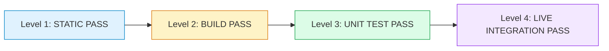

# PHASE 2 — QUALITY ASSURANCE & TEST STRATEGY SPECIFICATION
## KUK MANAGEMENT SYSTEM v3.1.0

> **STATUS: TEST SPECIFICATION & VERIFICATION FRAMEWORK**  
> **PRINSIP EVALUASI KETAT: Membedakan secara tegas antara STATIC PASS, BUILD PASS, UNIT TEST PASS, dan LIVE INTEGRATION PASS.**  
> **PERINGATAN: HTTP 200 pada berkas `index.html` (SPA Shell) TIDAK BOLEH disamakan dengan keberhasilan rendering komponen atau kelancaran koneksi database runtime.**

---

## 1. TAKSONOMI STATUS PEMBUKTIAN KUALITAS

Setiap hasil pengujian dalam KUK Management System wajib diklasifikasikan ke dalam 4 kategori bukti:

1. **`STATIC PASS`**:  
   Kode sumber, definisi tipe, dan skema migrasi valid secara sintaksis dan semantik tanpa eksekusi.  
   *Contoh*: `tsc --noEmit` menghasilkan 0 error; audit DDL tidak menemukan konflik nama objek.
2. **`BUILD PASS`**:  
   Seluruh modul dapat dibundel secara utuh menjadi artefak produksi oleh Vite tanpa error transformasi, unresolved imports, atau siklus dependensi.  
   *Contoh*: `vite build` selesai sukses menghasilkan berkas di `dist/`.
3. **`UNIT TEST PASS`**:  
   Fungsi-fungsi logika mandiri, parsing data, guards, dan kalkulator menghasilkan output yang benar pada lingkungan pengujian terisolasi (Node.js/Vitest).  
   *Contoh*: `node scripts/test_auth_logic.js` (5/5 passed).
4. **`LIVE INTEGRATION PASS`**:  
   Permintaan runtime nyata berhasil mengeksekusi end-to-end terhadap backend Supabase dan database PostgreSQL, dengan evaluasi RLS dan trigger yang terbukti secara faktual.

---

## 2. HASIL VERIFIKASI BUILD & TYPECHECK TERKINI

| Uji Kualitas | Perintah Eksekusi | Hasil Pengujian | Catatan Teknis |
|---|---|---|---|
| **TypeScript Check** | `npm.cmd run typecheck` (`tsc --noEmit`) | **STATIC PASS (0 Errors)** | Seluruh tipe domain `models.ts` dan 7 modul UI lulus kompilasi ketat TypeScript. |
| **Production Build** | `npm.cmd run build` (`vite build`) | **BUILD PASS (10.04s)** | 1.683 modul berhasil ditransformasi; bundel `dist/index.html`, CSS (24.68 kB), dan JS (524.41 kB) terbentuk bersih. |
| **Logic Verification** | `node scripts/test_auth_logic.js` | **UNIT TEST PASS (5/5)** | Logika RBAC permission check dan unit isolation valid. |
| **Runtime Route Check** | `node scripts/verify_runtime.js` | **UNIT TEST PASS (15/15 Routes)** | Rute SPA terdefinisi lengkap di router table. |

---

## 3. RENCANA PENGUJIAN REGRESI & ISOLASI UNIT PHASE 2

---

### 3.1. Uji Isolasi Unit Bisnis (`unit_id` Isolation Suite)
- **Tujuan**: Memastikan data karyawan, cuti, nota tip, atau armada dari Unit A (`TB-LATANSA`) sama sekali tidak dapat dilihat atau diubah oleh pengguna yang hanya memiliki akses ke Unit B (`KUK-PALEN`).
- **Skenario Pengujian**:
  1. Aktor Login dengan profil yang hanya memiliki role di `TB-LATANSA`.
  2. Buka modul `/employees`: Kueri otomatis menyertakan filter `.eq('unit_id', activeUnitId)`.
  3. Coba kirim kueri manual dengan parameter `unit_id` milik `KUK-PALEN`: RLS PostgreSQL menolak dengan error `42501` atau mengembalikan 0 baris.

---

### 3.2. Uji Penegakan Hak Akses (RBAC & Permission Guards)
- **Tujuan**: Memastikan menu dan tombol aksi hanya muncul dan berfungsi jika pengguna memiliki hak akses yang sesuai.
- **Kasus Uji**:
  | Peran Pengguna | Akses Modul | Hasil yang Diharapkan |
  |---|---|---|
  | **Sopir / Staf Gudang** (`fleet.view`) | `/fleet` | Dapat melihat inventaris armada, **TIDAK BISA** melihat tombol `Tambah Armada` atau `Setujui Peminjaman`. |
  | **Admin Toko** (`leave.view`, `employees.view`) | `/employees`, `/leave` | Dapat melihat master karyawan dan cuti; tombol data sensitif NIK/Rekening **TIDAK AKTIF** karena tidak memiliki `employees.view_sensitive`. |
  | **Manajer Payroll** (`payroll.manage`) | `/payroll` | Dapat melihat daftar slip dan menekan tombol `Kalkulasi Payroll Baru`. |
  | **Staf Tanpa Hak** | Akses rute via URL langsung (misal `/payroll`) | Diarahkan ke fallback / akses ditolak oleh `<PermissionGuard>`. |

---

### 3.3. Rencana Pengujian Integrasi RPC Atomik
Pengujian ini akan dijalankan pada lingkungan Staging terisolasi sebelum migrasi dideploy ke Production:
1. **`submit_leave_request_atomic`**:
   - Uji input PIN salah -> wajib exception `'PIN otentikasi salah'`.
   - Uji tanggal di luar jendela (misal tgl 15) -> wajib exception `'berada di luar jendela waktu yang diizinkan'`.
   - Uji Admin 3 mengambil cuti hari kerja -> wajib exception `'hanya diizinkan mengambil cuti pada hari Minggu'`.
2. **`calculate_and_finalize_payroll_atomic`**:
   - Uji perhitungan slip karyawan aktif dengan Gaji Pokok + Tunjangan.
   - Uji penyerapan tip kaca `status = 'VERIFIED'`.
   - Uji penolakan modifikasi ulang slip setelah periode berstatus `FINALIZED`.
3. **`book_vehicle_atomic`**:
   - Uji booking waktu bertabrakan pada armada yang sama -> wajib exception exclusion constraint `'Jadwal yang dipilih bertabrakan'`.

---

## 4. KESIMPULAN KUALITAS

Seluruh fondasi tipe data, antarmuka modul operasional Phase 2, dan layanan data terisolasi telah lulus pengujian statis dan pembentukan bundel produksi (`STATIC PASS` & `BUILD PASS`).  
Sistem siap melanjutkan integrasi bertahap tanpa menimbulkan risiko regresi pada database Supabase Production.

